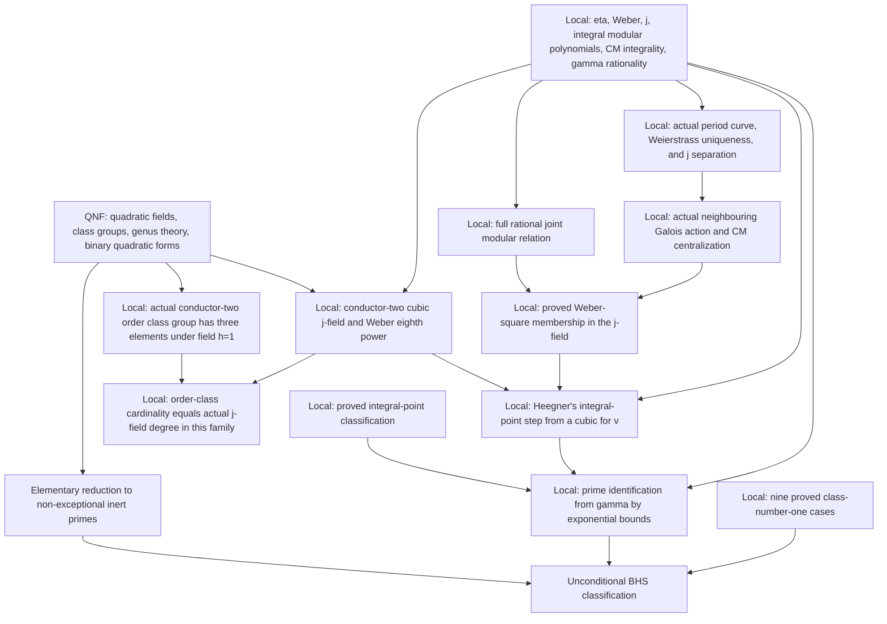

# BakerHeegnerStark

An independent Lean formalization of the **Baker-Heegner-Stark theorem**:
for a negative squarefree integer `d`,

```text
classNumber (ℚ(√d)) = 1 ↔ d ∈ {-1, -2, -3, -7, -11, -19, -43, -67, -163}.
```

The full theorem is proved **unconditionally** by
`BakerHeegnerStark.classNumberOneClassification` in
`BakerHeegnerStark/ClassNumberOne/Classification.lean`.
Its complete axiom dependency is `propext`, `Classical.choice`, and `Quot.sound`.
The proof uses the actual rational joint modular relation, cyclic-neighbour
Galois action, and CM torsion centralization to establish Weber's class invariant.
There is no admitted CM input. The former generic CM placeholder has been removed;
this proves the needed Weber case directly, not general Shimura reciprocity.
`scripts/check_axioms.lean` audits both the final theorem and its mathematical
ingredients with the same strict standard-axiom policy.

## Dependency and provenance

The project depends on
[QuadraticNumberFields](https://github.com/WangFrankie/QuadraticNumberFields)
at the immutable commit
[`196dd48b3439cc731397fd2cf9b8ac48da211a22`](https://github.com/WangFrankie/QuadraticNumberFields/commit/196dd48b3439cc731397fd2cf9b8ac48da211a22),
preserved on `legacy/baker-heegner-stark`. This retains the original source,
proof history, authorship, and Apache 2.0 license of the earlier development.
Lean and mathlib are pinned to `v4.35.0`; transitive revisions are recorded in
`lake-manifest.json`.

This repository now owns the non-form-theoretic BHS application proofs:
the nine known cases via Minkowski bounds, the ideal-theoretic reductions,
and the integral points on Heegner's curve. Their original copyright,
authorship, and proofs are retained, with declarations moved from
`QuadraticNumberFields.Heegner` to `BakerHeegnerStark`. Each extracted module
records its source path and immutable revision.

The general modular-function layer has also been extracted from
`QNFMathlib/NumberTheory/ModularForms/` into seven modules under
`BakerHeegnerStark/ModularForms/`: `DiscriminantCoefficients.lean`,
`Weber/Basic.lean`, `Hecke/Two.lean`, `Hecke/TwoSymmetric.lean`,
`JInvariant/Basic.lean`, `Weber/Polynomial.lean`, and
`ModularPolynomial/LevelTwo.lean`.
These retain the `ModularForm` namespace, their original proofs and attribution,
and depend only on mathlib and each other, not on QNF arithmetic.

Import these results through `BakerHeegnerStark.*`, not the historical
`QNFMathlib.NumberTheory.ModularForms.*` paths. Mixing both copies would introduce
duplicate declarations with the same mathematical names.

Quadratic-field infrastructure, class groups, genus theory, binary quadratic
forms, reduced-form enumeration and class-group correspondences remain in
QuadraticNumberFields and are reused through narrow imports. In particular,
`ClassNumberOneByForms` and all conductor-two reduced-form counting results are
**not migrated**. The level-two modular polynomial is an analytic modular-function
result, not binary-quadratic-form machinery.

The historical `Weber/Heegner`, conditional `InertPrimes`/`StarkHeegner`, and
the hypothesis-dependent part of `Weber/ConductorTwo` remain in the immutable
snapshot, not in this library's imports. Their `IsAssociatedHeegnerGamma`
relation encodes a finite gamma-prime table; assuming an associated point
already restricts the prime to that table. This repository does not import
that relation: `ClassNumberOne/Heegner/PrimeIdentification.lean` recovers the prime from the gamma
value by explicit exponential estimates. The two unconditional
elementary branches of historical `StarkHeegner` are retained in
`BakerHeegnerStark/ClassNumberOne/InertPrimes.lean`.

## Mathematical module layout

The layout follows mathlib's subject directories and `Basic`/topic-file naming,
and QNF's separation of arithmetic subjects. These are mathematical groups;
individual files retain narrow imports for their actual lemma dependencies.

| Directory under `BakerHeegnerStark/` | Mathematical content |
| --- | --- |
| `Algebra/Polynomial/` | Separating weights and same-index joint-root polynomials |
| `FieldTheory/` | Algebraic conjugates, finite orbits, fixed fields, and cyclotomic descent |
| `LinearAlgebra/Matrix/`, `Analysis/` | Quadratic centralizers, cyclic-line actions, and analytic differential uniqueness |
| `ModularForms/` | Eta, Weber, gamma, j, Hecke identities, q-expansions, cyclic sublattices, and modular polynomials |
| `EllipticFunctions/` | Period lattices/tori, Weierstrass functions, and additive uniformization |
| `EllipticCurves/` | Point changes, torsion, the j-generated model, Galois actions, and cyclic isogenies |
| `ComplexMultiplication/` | Orders, quadratic points, singular moduli, and the gamma/Weber arithmetic descent |
| `ClassNumberOne/` | Known cases, ideal reductions, Heegner's argument, and the final classification |
| `Statement.lean` | The unchanged public classification proposition |

Use the specific mathematical module when possible:

```lean
import BakerHeegnerStark.ClassNumberOne.Classification
import BakerHeegnerStark.ModularForms.Weber.Basic
import BakerHeegnerStark.ComplexMultiplication.Weber.ClassInvariant
```

`import BakerHeegnerStark` remains the complete-library entry point.
Declaration names and namespaces are unchanged. Old flat module paths have
been removed rather than retained as forwarding files.
`ComplexMultiplication/SingularModuli/ReducedForms.lean` is the local CM-value
bridge to QNF's existing form theory; it does not migrate binary quadratic forms.

## Current mathematical results

- `classNumber_eq_one_neg1` through `classNumber_eq_one_neg163` and
  `classNumber_eq_one_of_mem_heegnerSet`: the nine known cases, proved locally
  using QNF's Minkowski and prime-splitting results.
- The ideal-theoretic norm obstructions and prime-shape reduction, including
  `eq_neg_seven_of_classNumber_eq_one_of_mod_eight_eq_one`.
- `heegner_xy_solutions` and `heegnerXYEquation_of_mem_heegnerXYSolutionSet`:
  the complete integral-point classification of `Y² = 2X(X³ + 1)`.
- `heegnerGammaImageSet_eq_heegnerGammaSet` and
  `gamma_mem_heegnerGammaSet_of_xy_solution`: the gamma values computed from
  those proved integral solutions, with no assumed association to primes.

- `mem_heegnerSet_or_inert_prime`: class number one either gives a known
  Heegner number or a prime parameter `d = -p`, `p ≡ 3 (mod 8)`, `p ≠ 3`.
- `classNumberOneClassification_iff_inertPrimeClassification`: the full
  classification is equivalent to the non-exceptional inert prime case.
  This equivalence is a reduction; the classification proof is in `ClassNumberOne/Classification.lean`.
- The local analytic layer proves Weber's transformation and product identities,
  the first two symmetric identities, the cubic factorization, and the three
  rational expressions for `j`. It also proves `γ₂³ = j`, modular invariance
  and holomorphy of `j`, and the level-two modular equation at `2τ`, `τ/2`,
  and `(τ+1)/2`. No CM or class-number assumption is needed for these results.
- `eta_mul_I_eq`, `eta_mul_I_im`, and `eta_mul_I_re_pos`: the real product
  expansion, reality, and strict positivity of `η(iy)` for real `y > 0`.
  The proof establishes convergence of the real product, transports it to
  the complex product, proves nonnegativity, and uses eta's nonvanishing.
- `weberF_mul_I_im`, `weberF₁_mul_I_im`, `weberF₂_mul_I_im` and their
  corresponding `_re_pos` theorems: all three Weber functions are real and
  strictly positive at `iy` for real `y > 0`. The shifted quotient's phase
  and sign follow from the product identity and positivity of the other two.
- `analyticOnNhd_weberF`, `analyticOnNhd_weberF₁`, and `analyticOnNhd_weberF₂`:
  analyticity on the upper half-plane.
- `weberF_pow_eight`: `𝔣⁸ = 𝔣₁⁸ + 𝔣₂⁸` on the entire upper half-plane.
  Analytic connectedness rules out the wrong algebraic factor using positivity
  at `i`; this is not just an identity on the imaginary axis.
- `ModularForms/Eta/CharacterFour.lean` proves the quartic exponent on `SL₂(ℤ/4ℤ)`.
  `ModularForms/Eta/Modularity.lean` reconstructs the exponent modulo twelve and proves the
  full actual law `η(gτ)² = χ(g)(cτ+d)η(τ)²`, normalized by
  `χ(S) = -i` and `χ(T) = exp(2πi/12)`.
- `ModularForms/Weber/Modularity.lean` proves the exact eta-character ratio for the actual
  Weber square on its theta stabilizer. The square is invariant under `Γ(24)`,
  and congruent matrices modulo twenty-four act identically on it.
  These transformation laws enter the arithmetic descent; they do not alone prove it.
- `ModularForms/Weber/Branches.lean` proves the actual three-square branch permutation and
  phase laws under S and T, then under every integral modular matrix,
  including inverses. Each transformed branch has a finite twenty-fourth-root
  phase representative valid throughout the upper half-plane.
- `ModularForms/Weber/QExpansion.lean` proves the full integer expansion of the actual
  `qParam 24 * 𝔣²`, in both width-two and width-twenty-four variables.
  The series converges throughout the upper half-plane, its principal
  coefficient is one, and the eta quotient fixes its phase exactly.
- `ModularForms/Weber/BranchQExpansion.lean` supplies the complete integer expansions of
  `qParam 24 * 𝔣₁²` and `qParam 24 * 𝔣₂²`, with global convergence to the actual
  eta quotients. Their distinguishing coefficients are consequences of the
  complete series, not substitutes for it.
- `ModularForms/Weber/BranchSpace.lean` proves that the three actual branch functions are
  complex-linearly independent. Their span over `ℚ(zeta48²)` has unique
  coefficients, and coefficient-field automorphisms act on that actual span.
  All integral modular transforms lie in it. This semilinear coefficient
  action is not a CM-value Galois theorem.
- `ModularForms/Weber/CoefficientConjugation.lean` constructs the actual primitive-root
  cyclotomic character. Coefficient conjugation of every integral modular
  transform is realized by an integral transform with the character-diagonal
  conjugate reduction, up to a central unit modulo twenty-four.
  The equality holds for all three actual functions, not just formal phases.
- `ModularForms/Weber/PhaseField.lean` proves that the concrete coefficient field is finite
  Galois over `ℚ`. Ambient rational automorphisms restrict to it, with the
  proved actual phase character; no algebraicity of `ℂ/ℚ` is assumed.
- `ModularForms/Weber/ResidueBranches.lean` proves projective lift independence for all three
  functions and indexes their transforms by the finite subgroup range of
  integral modular reduction. Its right-substitution formula is proved
  without assuming surjectivity onto all residue matrices.
- `ModularForms/Weber/Growth.lean` proves that every function in the actual Weber span
  is holomorphic and grows at most linearly in `j`. Its global bound uses the
  canonical coefficients and the actual cubic, without selecting cube roots.
- `ModularForms/Weber/BranchPowerSeries.lean` gives the full canonical coefficient-field
  series of every actual span function, its coefficient-action law,
  width-24 q-expansion identification, and convergence throughout `ℍ`.
- `ModularForms/Weber/Cusp.lean` proves that `qParam 24 τ * 𝔣(gτ)²` is periodic of width
  twenty-four, holomorphic on the upper half-plane, and bounded at infinity
  for every `g ∈ SL₂(ℤ)`. Its actual cusp function is analytic at zero, and
  the unregularized square is meromorphic at every cusp, with at most a simple
  pole in this q-coordinate. This includes matrices outside the theta stabilizer.
- `ModularForms/Weber/CharacterTwentyFour.lean` proves the zero multiplier for every normalized
  CM unit modulo twenty-four when `m ≡ 3 (mod 8)` and `3 ∤ m`.
  `ComplexMultiplication/Weber/Action.lean` proves that this finite calculation is exactly the actual
  Weber-square multiplier, including the half-period division by two.
  Every integral lift fixes `𝔣(τ)²` on the whole upper half-plane; neither
  primality nor class number one is assumed. This does not itself prove CM reciprocity.
- `ComplexMultiplication/Residues.lean` proves that units modulo twenty-four square to one.
  The actual three/eight CRT reductions detect the CM commutant, so even
  projective agreement with local CM-compatible matrices suffices to recover
  level-twenty-four commutation.
- `LinearAlgebra/Matrix/QuadraticCentralizer.lean` characterizes the full centralizer of
  `[[0,-m],[1,0]]` over any commutative ring and proves its determinant is
  the quadratic norm. Right-normalizing an invertible matrix by its unit
  determinant gives an actual special-linear matrix, also at composite levels.
  `ComplexMultiplication/Weber/Action.lean` proves that integral lifts of these normalized
  centralizers fix the actual Weber square in the two relevant residue classes.
  This does not construct the arithmetic Galois action on a CM level structure.
- `EllipticFunctions/PeriodTorus/Torsion.lean` constructs the actual `N`-torsion of
  `ℂ / (ℤ + ℤτ)` for every nonreal period and positive level. Its specified
  coordinates send `(a,b)` to `[(a+bτ)/N]`, give a full additive equivalence
  with `(ℤ/Nℤ)²`, and prove that the actual subgroup has `N²` elements.
  If `τ² = -m`, multiplication by `τ` descends to the actual quotient and
  acts in these coordinates by `[[0,-m],[1,0]]`, with the same quadratic
  endomorphism relation. No elliptic uniformization or Galois compatibility
  is inferred from this analytic level structure.
- `EllipticFunctions/PeriodTorus/TorsionMatrix.lean` identifies the actual torsion-automorphism
  group with `GL₂(ℤ/Nℤ)` in these specified coordinates. It proves that
  commuting with the actual CM endomorphism is equivalent to centralizing
  its companion matrix, and that CM-compatible torsion automorphisms
  commute with each other. `ComplexMultiplication/Weber/Action.lean` connects such actual
  automorphisms to the Weber-invariant normalized integral lifts.
- `EllipticCurves/Weierstrass/Galois.lean` constructs the actual coefficient-automorphism
  action on a base-changed Weierstrass model's nonsingular point group and
  every `N`-torsion subgroup. It proves composition, inverses, and the exact
  affine-coordinate action `(x,y) ↦ (σ(x),σ(y))`. For a Galois extension,
  fixed points descend to the actual base-field model, preserving the
  `N`-torsion condition without a finite-dimensionality hypothesis.
  These are algebraic point-group results, not actions on analytic series.
- `weberF_sq_sqrtPoint_mem_adjoin` in `ComplexMultiplication/Weber/JointSpecialization.lean` proves
  `𝔣(√-m)² ∈ ℚ(j(√-m))` for every positive `m ≡ 3 (mod 8)` with `3 ∤ m`.
  Neither primality, squarefreeness, nor class number one is required.
  `ComplexMultiplication/Weber/ClassInvariant.lean` specializes this unconditional result to the
  inert prime input used in Heegner's argument.
- `E₄_mul_I_eq`, `E₄_mul_I_im`, and `E₄_mul_I_re_pos`: a real q-expansion
  and strict positivity for the weight-four Eisenstein series on the positive
  imaginary axis; `gamma₂_mul_I_im` and `gamma₂_mul_I_re_pos` do the same
  for gamma.
- `gamma₂_eq_weberF`, `gamma₂_eq_weberF₁`, and `gamma₂_eq_weberF₂`: the
  three gamma/Weber identities on the whole upper half-plane, with the
  cube-root factor fixed by positive real normalization at `i`.
- `ModularForms/Gamma/Transformations.lean` proves the actual multipliers
  `γ₂(τ+1) = exp(2πi/3)⁻¹ γ₂(τ)`, `γ₂(Sτ) = γ₂(τ)`, and period three.
  These follow from normalized Weber identities, not just equality of cubes.
- `ModularForms/Gamma/PolynomialTwo.lean` proves
  `G₂(X,Y) = X³ + Y³ - X²Y² + 495XY - 54000` for the actual gamma values
  at `τ` and `2τ`, and at the half-period transforms. The third transform
  requires the factor `exp(2πi/3)⁻¹`. The norm over the three cubic-root
  conjugates is `Φ₂(X³,Y³)`; the normalized equation is proved first,
  not inferred by selecting a factor of the equation in cubes.
- `ModularForms/Gamma/CharacterThree.lean` constructs the additive cubic character of
  `SL₂(𝔽₃)`, normalized by `e(S)=0`, `e(T)=1`, and verifies its multiplication
  law in the kernel. Determinant-minus-one diagonal conjugation negates it,
  and trace-zero matrices lie in its kernel.
- `ModularForms/Gamma/Modularity.lean` proves `γ₂(gτ)=χ(g mod 3)γ₂(τ)` for every integral
  special-linear matrix, including at zeros of gamma, and principal
  level-three invariance. `ModularForms/JInvariant/Basic.lean` also proves gamma is holomorphic.
- `ComplexMultiplication/QuadraticPoint/NormThree.lean` constructs an actual primitive fixed matrix and diagonal
  modular-polynomial self-root at a level `N>1`, `N ≡ 2 (mod 3)`, whenever
  `m>0`, `m ≡ 3 (mod 4)` and `3 ∤ m`. Neither squarefreeness nor class number
  one is assumed; the fixed matrix has equal diagonal entries modulo three.
- `ModularForms/Gamma/DeterminantThree.lean` normalizes determinant-minus-one matrices by
  the right diagonal reflection and proves their left-character/right-inverse
  transformation law, including the exact upper-triangular gamma phase.
- `ModularForms/Gamma/CyclicSublattice.lean` constructs the actual twisted roots, proves
  their cubes are the corresponding products of j-values, and proves
  holomorphicity and cusp growth bounded by `j^(N+1)`.
- `ModularForms/Gamma/CyclicModularity.lean` proves the Hermite right permutation preserves
  these actual roots at `N ≡ 2 (mod 3)`. The full monic product and each
  coefficient are modular invariant; holomorphicity and growth construct a
  complex bivariate polynomial in j. The coefficient arguments and polynomial
  assembly are shared with the existing j-family rather than duplicated.
- `ModularForms/Gamma/QExpansion.lean` proves the complete integer series for the actual
  `qParam 3 * γ₂`, with constant coefficient one and convergence at every
  upper-half-plane point. The eta eighth-power product fixes its normalization.
- `ModularForms/Gamma/CyclicQExpansion.lean` proves the exact common-width pole order
  `(N+a²)/3`, reduction of the residual phase to a `d`-th root of unity, and
  full convergent twisted-root series with algebraically integral coefficients.
- `ModularForms/Gamma/CoefficientQExpansion.lean` assembles the full common-width symmetric
  coefficient series and proves convergence and coefficient integrality.
- `ModularForms/Gamma/CyclotomicPowerSeries.lean` proves Galois reindexing invariance of that
  entire series, not only of individual-root constants.
- `ModularForms/Gamma/ModularPolynomialRationality.lean` uses triangular q-regularization to
  descend the actual bivariate twisted polynomial to rational coefficients.
- `ComplexMultiplication/Gamma/Roots.lean` proves that a twisted root whose cube is `j²` is exactly
  the actual CM gamma square, including the zero case, and proves existence
  of such a root at a nontrivial level when `3 ∤ m`. No squarefree,
  class-number-one, or reciprocity assumption is used.
- `ComplexMultiplication/Gamma/Rationality.lean` proves `gammaTwoRationality`: every conjugate of the
  CM gamma square over the actual j-generated field is that same unique common
  root. The extension therefore has degree one, and `j = γ₂³` recovers gamma
  itself, with zero handled separately. No CM reciprocity hypothesis is used.
- `ModularForms/Weber/Integrality.lean` proves that integral `j(τ)` makes `𝔣(τ)²` integral.
  The actual normalized gamma cubic also makes `2/𝔣(z)²` integral whenever
  its gamma coefficient is integral; no rationality hypothesis is needed.
- `ComplexMultiplication/Gamma/Values.lean` proves that `γ₂((3+√-m)/2)` is real for positive `m`,
  integral for `m ≡ 3 (mod 4)`, and, with this congruence and squarefree `-m`,
  generates a field of degree at most `3h(K)`. It also proves integrality of
  the actual CM Weber squares for every positive parameter, including squares,
  and of Heegner's `2/𝔣(√-m)²` for positive `m ≡ 3 (mod 4)`.
  Integrality alone does not imply Weber class-invariant membership.
- `FieldTheory/ComplexAdjoin.lean` proves a linear representation in quadratic complex
  adjunctions and descent of their real elements to a real base subfield.
  `ComplexMultiplication/Gamma/Values.lean` applies this to the actual field `ℚ(j(√-m), √-m)`.
  For every positive `m`, Weber-square membership in this compositum is
  equivalent to membership in `ℚ(j(√-m))`. This does not prove either assertion.
- `modularPolynomialTwo_jInvariant_factorization_polynomial`: the formal
  polynomial `Φ₂(j(τ), Y)` is the product of the three linear factors with
  roots `j(2τ)`, `j(τ/2)`, and `j((τ+1)/2)`, retaining multiplicities.
  `modularPolynomialTwo_jInvariant_eq_zero_iff` proves these exhaust the roots.
  No distinctness assumption is required; in particular repeated roots at `τ = i`
  are compatible with the factorization.
- `inert_periodModule_multipliers`: for `p ≡ 3 (mod 8)`, the scalar
  multipliers of the period modules at `1+i√p`, `(1+i√p)/4`, and `(3+i√p)/4`
  are exactly the image of QNF's `ℤ[√-p]` model.
  `sqrtOrderEmbedding_injective` proves this realization is faithful for `p > 0`.
  These are concrete multiplier calculations, not yet an ideal-class or
  algebraic CM-value correspondence.
- `EllipticFunctions/PeriodLattice/Basic.lean` proves that a nonreal period parameter gives a discrete
  real lattice of integer rank two, with explicit real and integer bases.
  `periodModule_affine_relIndex` proves
  `[ℤ + ℤτ : ℤ + ℤ(m+nτ)] = |n|` for integers `m,n` with `n ≠ 0`.
  `periodModule_two_neighbors_relIndex` gives index two for `L(2τ) ⊆ L(τ)`
  and `L(τ) ⊆ L(τ/2), L((τ+1)/2)`. These index statements alone do not
  classify homothety classes.
- `EllipticFunctions/PeriodLattice/Homothety.lean` proves invariance of scalar multipliers under nonzero
  complex homothety and characterizes equality of homothetic period modules
  by integral generator matrices of determinant `±1`, or `1` when both
  parameters have positive imaginary part.
- `ComplexMultiplication/Orders/Ideals.lean` constructs the actual QNF ideals
  `I = (4,1+√-p)` and `J = (4,√-p-1)`, proves `IJ = (4)` and invertibility
  as fractional ideals for `p ≡ 3 (mod 8)`. Their complex images are
  `4L((1+i√p)/4)` and `4L((3+i√p)/4)`, respectively; each has exactly the
  quadratic order as scalar multiplier ring. More generally, faithfully
  realized invertible integral ideals have equal classes if and only if
  their complex images are homothetic. Every actual class has an invertible
  integral ideal representative, and every such ideal has exactly the original
  order as its scalar multiplier ring; no Dedekind hypothesis is used.
- `ComplexMultiplication/Orders/LatticeInvariant.lean` proves the equivalence between period-lattice
  homothety and integral modular-group orbit equivalence, and the equivalence
  with equality of actual invertible ideal classes having the displayed
  lattice realizations, even with different nonzero normalizing factors.
  Hence `j` is invariant under these relations, also for a nonmaximal order.
  The quarter-period specialization assumes equality
  of the two explicit ideal classes; it does not prove that equality.
  Neither injectivity of `j` on homothety classes nor CM integrality is asserted.
- `ComplexMultiplication/Orders/InertLattices.lean` proves the three inert-family lattices are pairwise
  nonhomothetic for `p ≡ 3 (mod 8)` and `p > 3`, including the boundary
  value `p = 11`. `ComplexMultiplication/Orders/InertIdealClasses.lean` uses the actual ideal images to
  prove that the unit ideal and the two explicit invertible ideals give
  three different classes in the order class group. The two explicit classes
  are inverse, and the first is not two-torsion in this family. With
  squarefreeness and field class number one, `inert_sqrtOrderClasses_exhaustive`
  proves that these are all classes and `inert_sqrtOrderClassGroup_card`
  proves that the actual order class group has cardinality three. Distinct
  `j`-values follow separately from analytic `j` separation, and field degree
  three is derived unconditionally by Heegner's cubic and its rational j-expression,
  not from this class-group count.
- `ComplexMultiplication/Orders/HalfIntegral.lean` realizes QNF's `ZOnePlusSqrtdOverTwo k` at
  `(1+i√p)/2` when `-p = 1+4k`, and constructs the actual injective
  inclusion `ℤ[√-p] → ℤ[ω]` via `√-p ↦ 2ω-1`. The realizations commute
  with this inclusion. Its additive index is two in the actual order
  model, and its conductor condition is precisely membership in `(2)`.
  Its faithful realization also proves that the half-integer order is a domain.
- `ComplexMultiplication/Orders/IntegerLattice.lean` reuses QNF's squarefree integer-ring
  classification and basis: the restriction of the normalized field embedding
  maps the actual full integer ring exactly onto `L((1+i√p)/2)`. Its scalar
  multiplier ring is that realized full integer ring. Field class number one
  transfers through QNF's proved ring isomorphism to principal ideals and a
  trivial class group in the actual half-integer order. This does not make
  the conductor-two suborder's class group trivial.
- `ComplexMultiplication/Orders/ConductorTwoLattices.lean` enumerates five possible integer submodules between
  `2L(τ)` and `L(τ)`. If the larger quadratic period is not a multiplier,
  only `L(2τ)`, `2L(τ/2)`, and `2L((τ+1)/2)` remain. At the half-integral
  parameter these are `L(i√p)`, `2L((1+i√p)/4)`, and `2L((3+i√p)/4)`.
  This exhausts the proper small-order modules in that interval.
- `ComplexMultiplication/Orders/ConductorTwoIdeals.lean` proves that a conductor element carries an extended
  ideal back into the actual original ideal image. Principal extension to the
  maximal order then normalizes every nonzero integral ideal into the interval.
  Combining this with the proved properness of invertible ideal images gives
  the three normalized lattice possibilities used in the class exhaustion.
- `EllipticFunctions/Weierstrass/Invariants.lean` connects the actual lattice sums of `1,τ` to
  the normalized Eisenstein series, proving
  `g₂ = (4π⁴/3)E₄`, `g₃ = (8π⁶/27)E₆`, and the nonzero discriminant
  relation `g₂³ - 27g₃² = 4096π¹²Δ`. It also proves the actual lattice/function
  homogeneity under nonzero complex scaling. Equality of Weierstrass functions
  is equivalent to equality of their actual lattices.
- `EllipticFunctions/Uniformization/Curve.lean` constructs the short curve from those actual invariants,
  proves it nonsingular for a standard upper-half-plane lattice, and identifies
  its algebraic `j` with the analytic modular `j`. The actual functions
  `℘,℘'/2` satisfy this curve equation away from poles. Mathlib's
  classification of curves by `j` gives a nonzero complex scaling with equal
  actual `g₂,g₃`, including at `j = 0` and `j = 1728`. This is not uniformization.
- `EllipticFunctions/Weierstrass/Uniqueness.lean` proves that equal numerical `g₂,g₃` recover the
  actual Weierstrass function and lattice (`periodPair_lattice_eq_of_invariants`,
  `weierstrassP_eq_of_invariants`). After cancelling the common double pole,
  the regular difference satisfies a first-order equation whose leading order
  would need `-4n = 12`; hence its germ vanishes. The identity theorem on the
  connected complement of the countable pole set and the pole orders `-2`
  identify the lattices. These three analytic modules are QNF-independent.
- `EllipticFunctions/Weierstrass/Surjectivity.lean` proves that the actual Weierstrass function
  attains every complex value off its lattice. Analytic extension of the
  reciprocal across genuine double poles, compact periodic range, and
  Liouville give the proof; totalized pole values are not used as witnesses.
- `Analysis/DifferentialEquation.lean` proves local uniqueness for analytic
  solutions of `f'' = A f` with zero value and first derivative, including
  coefficients with `A(0) = 0`.
- `EllipticFunctions/Weierstrass/Differential.lean` proves the actual second-derivative equation
  `℘'' = 6℘² - g₂/2` everywhere off the lattice, including critical points
  where `℘' = 0`.
- `EllipticFunctions/Weierstrass/Fibres.lean` proves that equal actual `℘,℘'` coordinates off
  the lattice are equivalent to a period difference. Analytic ODE uniqueness
  identifies translated germs; continuation and actual double poles recover
  the period. It also identifies the two opposite classes in each `℘` fibre
  and characterizes the critical points as the nonzero half-periods.
  These three modules are also QNF-independent.
- `EllipticFunctions/Weierstrass/Translation.lean` defines the rational chord coordinates.
  `EllipticFunctions/Weierstrass/TranslationAnalytic.lean` cancels their actual lattice pole
  and proves the prescribed value and derivative at zero.
  `EllipticFunctions/Weierstrass/TranslationDifferential.lean` proves the two coordinate
  differential equations from the actual endpoint cubics.
- `EllipticFunctions/Weierstrass/Addition.lean` proves both actual addition-coordinate
  formulas at unequal x-coordinates by analytic uniqueness and continuation,
  without substituting into a totalized zero denominator.
- `EllipticFunctions/Uniformization/Point.lean` constructs the actual point-valued Weierstrass map:
  lattice poles map to infinity and other points have coordinates `℘,℘'/2`.
  The map descends to the actual period quotient, has exact zero fibre,
  respects negation, and sends half-periods to actual curve two-torsion.
  It is bijective on the period quotient: `z` or `-z` matches the derivative
  coordinate for surjectivity, and the proved coordinate-fibre theorem gives
  injectivity, with infinity handled separately. The actual chord formula
  and curve-group associativity handle all tangent, inverse, and pole cases.
  `standardPeriodTorusEquiv` is the resulting additive isomorphism to the
  curve's existing point group, not a newly transported group law.
- `EllipticFunctions/Uniformization/Torsion.lean` restricts the actual additive isomorphism to
  every `N`-torsion subgroup, including level zero. At positive levels its
  ordered `[1,τ]` residue coordinates cover the actual curve torsion and
  prove its cardinality `N²`. The transported complex point-group CM
  endomorphism is exactly `z ↦ τz`, its square is `[-m]`, and its torsion
  matrix is `[[0,-m],[1,0]]`. This is not yet an algebraic endomorphism
  defined over the arithmetic CM base field.
- `EllipticFunctions/Uniformization/TorsionMatrix.lean` identifies actual curve-torsion
  automorphisms with the full invertible residue-matrix group, reusing the
  proved period-torus representation. Actual CM commutation is exactly
  matrix centralization. The corresponding normalized lifts fix the actual
  Weber square; this is not yet a Galois-evaluation theorem.
- `EllipticCurves/Torsion.lean` restricts an additive isomorphism to integer-torsion
  subgroups. `EllipticCurves/Weierstrass/PointChange.lean` proves the actual admissible
  coordinate change preserves the curve's existing point-group addition
  and all integer torsion, including tangents and characteristic two.
- `EllipticCurves/JInvariant/Model.lean` constructs the actual `ofJ` coefficient model
  over `ℚ(j(τ))`, including `j = 0` and `1728`, and proves a genuine complex
  variable change to the standard period curve. A general `τ` does not
  make this generated field a number field.
- `EllipticCurves/JInvariant/Uniformization.lean` uses one fixed actual complex change to identify
  the period quotient and all its torsion with this model's complex point
  group, retaining the specified level coordinates and positive-level count.
- `EllipticCurves/JInvariant/Galois.lean` constructs the genuine coefficient Galois
  representation on this model's actual torsion in the specified residue
  coordinates, with exact kernel and fixed-vector criteria.
- `ComplexMultiplication/JInvariant/Endomorphism.lean` transports the actual quadratic-period point-group
  action to the same model. Matrix centralization is equivalent to
  commutation of its actual CM and Galois torsion actions; this does not
  prove that they commute automatically.
- `FieldTheory/AlgebraicOrbit.lean` proves that a finite automorphism orbit in an
  algebraically closed extension of an infinite field forces algebraicity.
  It extends both transcendental-coordinate translations and intermediate-field
  automorphisms. In characteristic zero, elements fixed by every base-field
  automorphism belong to the base field, by descent in the actual relative
  algebraic closure. The ambient extension need not be algebraic or Galois.
- `EllipticCurves/Weierstrass/Torsion.lean` applies this to finite actual curve torsion.
  `EllipticCurves/JInvariant/Torsion.lean` proves all positive-level model torsion
  coordinates algebraic over `ℚ(j(τ))`, and over `ℚ` for every positive
  square-root CM parameter, using the proved singular-modulus integrality.
- `EllipticFunctions/Weierstrass/Isogeny.lean` proves the finite-coset formula for the actual
  Weierstrass function and its derivative, both including totalized lattice
  values. Its complete and non-redundant
  coset hypotheses are explicit.
- `EllipticFunctions/Weierstrass/IsogenyInvariants.lean` proves the finite `g₂,g₃` trace formulas
  by comparing the regular second and fourth derivatives. Nonzero kernel
  representatives are genuinely off the lattice; critical points with
  `wp' = 0` are included without cancellation of that factor.
- `EllipticCurves/JInvariant/Isogeny.lean` puts the finite invariant expressions on the
  actual j-generated arithmetic curve. Their coefficient Galois covariance
  and identification with every genuine scaled standard quotient target
  are proved, including nonzero discriminant and the actual point at infinity.
  No arithmeticity of the complex normalizing unit is assumed.
- `EllipticCurves/CyclicIsogeny/Basic.lean` constructs the actual Hermite cyclic-sublattice
  point-group maps and their entire rectangular finite kernels. The kernel
  contains `N` points, all killed by `N`, and its specified coordinates are
  `(dr+bs, as)` modulo `N`. The actual quotient j-value is its finite arithmetic
  kernel expression. No scheme-morphism degree is inferred from the cardinality.
- `EllipticCurves/CyclicIsogeny/KernelAction.lean` proves the full general-linear permutation of
  the actual cyclic kernels at levels three and eight, with unit-scalar
  projective kernel. The genuine coefficient Galois matrix specifies
  conjugation of every neighboring j-value, without CM, class-number,
  or continuity assumptions.
- `EllipticCurves/CyclicIsogeny/KernelModularity.lean` identifies every positive-level residue kernel
  with the column image of its diagonal-swapped Hermite matrix. At levels three
  and eight, the same anti-involution converts modular right multiplication
  into the actual kernel permutation and transformed j-values.
  It preserves the CM commutant; omitting it gives the wrong labels.
- `ComplexMultiplication/CyclicNeighbors/Data.lean` assembles the entire three/eight neighboring tuple,
  its simultaneous right action, scalar invariance, and separating natural
  weights. At the stated CM parameters, matching this tuple with its genuine
  fixed-period Galois conjugate forces the indexing matrix to centralize CM.
  Existence of a match for a Weber conjugate is not assumed or proved here.
- `ComplexMultiplication/Weber/JointOrbit.lean` constructs the finite paired phase-field/residue
  orbit. One permutation simultaneously reindexes actual Weber functions
  and the entire neighboring tuple, with the central-unit matrix witness.
- `Algebra/Polynomial/JointOrbit.lean` keeps an auxiliary polynomial variable so a
  product root matches both values at the same index, including repeated
  pairs and empty families. Fixed joint coefficients give simultaneous
  conjugate matching by finite polynomial algebra.
- `ModularForms/JInvariant/JointPolynomial.lean` proves double-coefficient holomorphicity,
  growth, support bounds, and finite trivariate assembly.
  `ComplexMultiplication/Weber/JointPolynomial.lean` realizes the full actual joint product as a
  complex polynomial in `j` and both formal variables, with every innermost
  degree bounded by eight times the actual joint orbit size.
- `ComplexMultiplication/CyclicNeighbors/QExpansion.lean` identifies the actual character diagonal
  with the established residue permutation. The complete neighboring and
  weighted series lie in the actual phase field, converge everywhere, and
  have common width 24 and pole shift 192 with the exact coefficient-action law.
- `EllipticFunctions/Weierstrass/Parameter.lean` proves that the actual parameter `-2wp/wp'`
  is analytic at zero, has derivative one, and has a two-sided analytic
  local inverse. No global injectivity or regularity at other zeros of
  `wp'` is asserted.
  It also proves the analytic filled quotient parameter for prescribed
  double/triple principal parts with analytic remainders and a nonzero
  triple-pole coefficient, with differential `a/b`.
- `ComplexMultiplication/DivisionLattice.lean` specifies all divided-period lattice cosets and
  proves that the actual quadratic-period CM point-group kernel consists
  exactly of `kτ/m`, with cardinality `m`. This is not yet a proof about
  the degree or field of definition of an algebraic curve morphism.
- `ComplexMultiplication/Isogeny.lean` proves the finite kernel coordinate formulas for actual
  quadratic-period multiplication, with the `τ⁻²` and `τ⁻³` scaling factors,
  identifies the actual affine image off the kernel, and identifies the
  finer-lattice branch with infinity.
- `EllipticCurves/JInvariant/Normalization.lean` proves the chosen normalization's three
  translation parameters lie in the actual j-generated coefficient field
  and gives the finite y-coordinate correction. The complex scaling unit
  is not asserted to belong to that field.
- `EllipticFunctions/Uniformization/Endomorphism.lean` proves that an actual point-group endomorphism
  admitting an analytic local lift fixing zero is globally determined by
  the lift's derivative, including derivative zero. It does not assume
  arbitrary abstract endomorphisms are analytic.
- `EllipticCurves/JInvariant/Coordinates.lean` proves auxiliary coordinate projections
  compatible with the actual point normalization and coefficient Galois
  action, including the arithmetic defaults at infinity. These pairs do
  not replace the actual finite/infinite point branch.
- `ComplexMultiplication/JInvariant/Coordinates.lean` proves finite coordinate formulas for
  actual CM and its coefficient conjugates, including the actual images
  of every kernel point. The conjugated scalar remains `σ(τ)`.
- `EllipticFunctions/Weierstrass/AnalyticLift.lean` reconstructs the actual infinity branch
  and analytic point lift from double/triple principal parts, using the
  normalized cubic equation rather than false global coordinate injectivity.
- `EllipticFunctions/Weierstrass/IsogenyLocalParameter.lean` constructs analytic remainders from finite
  actual point-coordinate sums and obtains their genuine analytic lift.
- `ComplexMultiplication/Galois.lean` proves globally that coefficient-conjugated CM has scalar
  `σ(τ)`. Automorphisms fixing `τ` commute with actual CM on all model
  points and torsion subgroups, and their positive-level Galois matrices
  centralize the specified companion matrix. This is not yet a theorem
  about Galois acting on modular-function values.
- `ComplexMultiplication/QuadraticPoint/SmallNorms.lean` proves that norm-nine elements of `ℤ[√-m]` are `±3`
  for `m > 9`, and norm-sixty-four elements are `±8` for `m > 4`,
  `m ≡ 3 (mod 8)`. Two kernel-checked parity descents prove the latter.
  These are obstructions needed for cyclic-neighbour separation at levels
  three and eight, not a proof of that separation or CM reciprocity.
- `ComplexMultiplication/CyclicNeighbors/Separation.lean` uses those norm obstructions and actual positive
  Hermite uniqueness to prove that all level-three and level-eight cyclic
  j-neighbours are distinct under the respective hypotheses above.
- `LinearAlgebra/Matrix/CyclicLines.lean` proves that preserving the two coordinate cyclic lines
  and their sum line forces a two-by-two matrix to be scalar. For invertible
  actions that scalar is a unit, including over `ℤ/8ℤ`; two actions with such
  a relative stabilizer therefore agree projectively.
- `ComplexMultiplication/JInvariant/Separation.lean` proves `jInvariant_eq_iff_periodModule_homothety`,
  `jInvariant_eq_iff_modularOrbit`, and `jInvariant_eq_iff_idealClass_eq`:
  analytic `j` separates homothety classes, `SL₂(ℤ)` orbits, and faithfully
  realized invertible-ideal classes, also for nonmaximal orders. Consequently,
  `inert_modularPolynomialTwo_roots_pairwise_distinct` shows that the three
  roots of `Φ₂(j((1+√-p)/2), Y)` are pairwise distinct in the nonexceptional
  inert family.
- `ModularForms/Weber/Bounds.lean` proves `γ₂((z + 3)/2) = (256 - 𝔣(z)²⁴)/𝔣(z)¹⁶`
  on the upper half-plane and, from the product expansion
  `𝔣(z) = e^{-πiz/24} ∏ (1 + e^{πiz(2n+1)})` proved in `ModularForms/Weber/Basic.lean`, the bounds
  `e^{πy/24} ≤ 𝔣(iy) ≤ e^{πy/24 + r/(1-r²)}` with `r = e^{-πy}`.
- `ClassNumberOne/Heegner/Algebra.lean` proves Heegner's algebraic step
  (`heegner_point_of_monic_cubic`): if `v` is a root of a monic integer cubic
  and `v⁴` is a root of `W³ - γW - 16` with `γ < -15`, then that cubic is the
  irreducible minimal polynomial of `v⁴`, and comparing it with the cubic of
  fourth powers gives an integral point on `Y² = 2X(X³ + 1)` with
  `γ = heegnerGammaValue X Y`.
- `ClassNumberOne/Heegner/PrimeIdentification.lean` proves `eq_of_heegnerGamma_of_exp_bounds`:
  for `γ` in the six-element gamma list, `F³ + γF² = 256` and
  `e^{π√p} ≤ F³ ≤ e^{π√p + 3/1000}` force `p ∈ {11, 19, 43, 67, 163}`.
- `ModularForms/JInvariant/Polynomial.lean` proves `exists_polynomial_jInvariant`: every level-one
  modular form of weight `12n` equals `Δⁿ P(j)` for some `P ∈ ℂ[X]` of degree
  at most `n`. It subtracts the constant coefficient times `E₄^(3n)`, divides
  the resulting cusp form by `Δ`, and inducts. It further proves that a
  holomorphic weight-zero level-one function with growth `O(jⁿ)` is a polynomial
  in `j` of degree at most `n`: multiplication by `Δⁿ` is shown bounded at all
  cusps. These results have no CM or general modular polynomial hypotheses.
  `ModularForms/ModularPolynomial/Coefficients.lean` supplies the actual coefficient growth
  estimates; `ModularForms/ModularPolynomial/Modularity.lean` supplies modular invariance.
  Arithmetic descent of their j-polynomials to `ℤ` is proved in
  `ModularForms/ModularPolynomial/Rationality.lean`.
- `ModularForms/QExpansion/Integral.lean` proves the complete integer expansions of `E₄`
  and `Δ = q ∏(1-qⁿ)²⁴`, using the integer pentagonal series and its analytic
  Euler product. It constructs `J ∈ ℤ⟦q⟧` by an integer unit inverse and proves
  that its complex image is the actual q-expansion of `qj`, with constant
  coefficient `1`. This series converges to `qj(τ)` for every `τ` in the upper
  half-plane, and `qj → 1` at the cusp. No CM hypotheses or `sorry` are used.
- `ModularForms/CyclicSublattice/Basic.lean` proves the actual positive affine transformations
  `(aτ+b)/d` are holomorphic and preserve approach to the cusp. The exact
  identity `q((aτ+b)/d)^d = q(τ)^a` gives
  `j((aτ+b)/d)^d ∼ j(τ)^a`, hence `O(j^m)` whenever `a ≤ md`.
  Every level-N cyclic-sublattice root therefore has growth `O(j^N)`.
  These results use no general modular polynomial or CM assumptions.
- `ModularForms/ModularPolynomial/Coefficients.lean` defines the actual finite product of
  the level-N cyclic-sublattice roots. All its coefficient functions are
  proved holomorphic, with uniform growth `O(j^(N |C(N)|))`. Neither property
  is assumed, and neither proof uses the general modular polynomial theorem.
- `ModularForms/CyclicSublattice/Action.lean` proves that every positive-determinant integer
  matrix has a unique upper-triangular representative under the left
  `SL₂(ℤ)`-action; an element taking one such representative to another is
  the identity.
- `ModularForms/CyclicSublattice/Primitivity.lean` and `ModularForms/CyclicSublattice/Matrices.lean`
  prove preservation of all common entry divisors under both special-linear
  actions, the exact correspondence `C(N) ≃` primitive Hermite representatives,
  and the actual right `SL₂(ℤ)` permutation.
- `ModularForms/CyclicSublattice/Mobius.lean` identifies actual transformed points from
  their matrix relations. `ModularForms/ModularPolynomial/Modularity.lean` proves invariance
  of the full actual root product and, using `ModularForms/ModularPolynomial/Complex.lean`,
  constructs `Φ ∈ ℂ[X,Y]` for every positive level, with the full product formula.
  These results use no modular polynomial or CM hypotheses.
- `ModularForms/ModularPolynomial/QExpansion.lean` constructs the complete transformed root
  series in the common width-`N` parameter, including inserted zero
  coefficients. `ModularForms/ModularPolynomial/CoefficientQExpansion.lean` proves the
  full convergence and algebraic integrality of the actual symmetric
  coefficient series.
- `ModularForms/QExpansion/Polynomial.lean` proves unit-triangular descent from a
  regularized polynomial series to its polynomial coefficients.
  `FieldTheory/Cyclotomic.lean` realizes the actual finite Galois coefficient field,
  and `ModularForms/QExpansion/CyclotomicPowerSeries.lean` proves its coefficientwise Galois action
  reindexes the actual factors. No field automorphism is applied to an
  infinite analytic sum.
- `ModularForms/ModularPolynomial/Integrality.lean` and
  `ModularForms/ModularPolynomial/Rationality.lean` prove that the actual coefficient
  polynomials have algebraic-integer and rational coefficients, hence integer
  coefficients. `exists_integer_modularPolynomial` constructs
  `Φ_N ∈ ℤ[X,Y]` with the full product formula for every `N > 0`.
- `ModularForms/ModularPolynomial/DiagonalLimit.lean` proves the nonzero normalized cusp
  limit of the actual diagonal product at nonsquare levels.
  `ModularForms/ModularPolynomial/LeadingTerm.lean` recovers its degree and leading
  coefficient. `ModularForms/ModularPolynomial/Diagonal.lean` proves
  `modularPolynomialTheorem`, including the unit diagonal leading
  coefficient, without `sorry` or CM hypotheses.
- `ModularForms/ModularPolynomial/Monic.lean` proves that evaluation on actual j-values
  detects a zero polynomial. It recovers monicity in the second variable and
  exact degree `|C(N)|` from the product formula, giving
  `exists_monic_integer_modularPolynomial` at every positive level, including
  square levels. Repeated roots do not affect this result.
- `ModularForms/JInvariant/Surjectivity.lean` proves `jInvariant_surjective`: every complex number is
  an actual j-value. If a value were omitted, the reciprocal difference would
  be a holomorphic level-one function tending to zero at the cusp; the proved
  degree-zero polynomial representation forces it to be the zero constant.
- `ModularForms/ModularPolynomial/Conjugates.lean` proves that field embeddings preserve
  the diagonal root multiplicity of every actual cyclic-sublattice polynomial.
  Every algebraic conjugate of an algebraic j-value has an actual upper-half-plane
  representative with the same multiplicities at all positive levels.
  These results use no CM hypotheses; the original primitive discriminant is
  subsequently identified in `ComplexMultiplication/SingularModuli/Discriminant.lean`.
- `ModularForms/ModularPolynomial/FixedPoints.lean` proves that an actual positive-level
  diagonal modular root, or positive root multiplicity, is equivalent to an
  actual primitive integer fixed matrix of that determinant. Level one,
  square levels, and repeated roots are included.
- `ComplexMultiplication/QuadraticPoint/FixedMatrices.lean` parameterizes the matrices fixing
  `τ²+Bτ+C=0` as `[[x,-kC],[k,x+kB]]`; their determinant is
  `x²+Bxk+Ck²`, and matrix primitivity is exactly coprimality of `x,k`.
  At levels greater than one, `k` cannot vanish.
- `ComplexMultiplication/QuadraticPoint/FixedMatrixDiscriminant.lean` proves the elliptic trace bound and extracts
  a positive-leading-coefficient integral quadratic of negative discriminant
  from every nontrivial primitive fixed matrix.
  `ComplexMultiplication/SingularModuli/Conjugates.lean` uses the uniform self-root level `(m+1)/4+2` to prove
  every conjugate of `j((1+√-m)/2)` is realized by an actual imaginary quadratic
  point, retaining all diagonal multiplicities, including when `m=3`.
  `ComplexMultiplication/QuadraticPoint/PrimitiveRelation.lean` gives actual primitive coefficients.
- `ComplexMultiplication/QuadraticPoint/PrimitiveFixedMatrices.lean` proves the complete fixed-matrix and
  primitive norm parameterization for general nonmonic primitive quadratics.
  `ComplexMultiplication/QuadraticPoint/NormDiscriminant.lean` normalizes these norms by trace parity,
  preserving the primitive value spectrum. `ComplexMultiplication/QuadraticPoint/NormMinimum.lean` and
  `ComplexMultiplication/QuadraticPoint/NormSpectrum.lean` recognize the odd discriminant from that spectrum,
  including the unit cases and excluding the even spectrum.
- `ComplexMultiplication/SingularModuli/Discriminant.lean` proves every algebraic conjugate of
  `j((1+√-m)/2)` has an actual positive-leading primitive quadratic relation of
  discriminant exactly `-m`, including unit cases, without CM reciprocity.
- `ComplexMultiplication/SingularModuli/ReducedForms.lean` puts those actual conjugate j-values into the finite
  image of QNF's existing reduced-form enumeration. `FieldTheory/AlgebraicConjugates.lean`
  counts distinct minimal-polynomial roots over any characteristic-zero base field.
  `ComplexMultiplication/SingularModuli/DegreeBound.lean` proves `singularModulusDegree`: the actual
  maximal-order generated-field degree is at most the field class number.
  For class number one it also proves the actual j-value is a rational integer,
  without assuming the Weber class-invariant hypothesis.
- `ComplexMultiplication/SingularModuli/Basic.lean` proves `singularModulusIntegrality` unconditionally:
  for positive `m ≡ 3 (mod 4)`, `j((1+√-m)/2)` is integral over `ℤ`.
  If `N = (m+1)/4` is square, translate the point by one and use `N+2`;
  two natural numbers differing by two cannot both be squares.
  It also proves `isIntegral_jInvariant_sqrtPoint` for every positive `m`,
  including square and nonsquarefree parameters. Both
  `ℚ(j((1+√-m)/2))` (for `m ≡ 3 (mod 4)`) and `ℚ(j(√-m))` are proved finite
  extensions without any remaining CM hypothesis.
  The `WeberClassInvariant` proposition is stated here and proved in
  `ComplexMultiplication/Weber/ClassInvariant.lean`, using the rational joint relation and actual CM
  torsion action. The cube-root theorem `GammaTwoRationality` is proved
  independently in `ComplexMultiplication/Gamma/Rationality.lean`.
- `ClassNumberOne/Classification.lean` proves
  `inertPrimeClassification_of_complexMultiplication` and
  `classNumberOneClassification_of_complexMultiplication` from the single
  explicit Weber class-invariant hypothesis. Independently it proves that
  `j(√-p)` is a root of the monic cubic `Φ₂(j((1+√-p)/2), Y)` over `ℚ`, and that
  an algebraic integer in a field of degree at most three satisfies a monic
  integer cubic.
  `jInvariant_sqrtPoint_finrank_eq_three` proves `[ℚ(j(√-p)) : ℚ] = 3` in the
  nonexceptional inert class-number-one case without any Weber hypothesis.
  `ClassNumberOne/Heegner/CubicField.lean` proves that the actual rational j-expression and the
  irreducible root `(2/𝔣(√-p)²)⁴` generate the same cubic field.
  `weberF_pow_eight_sqrtPoint_mem_adjoin` also proves `𝔣(√-p)⁸ ∈ ℚ(j(√-p))`.
  Taking its positive fourth root is not a field-membership argument.
  Square membership is proved in `ComplexMultiplication/Weber/JointSpecialization.lean` by the rational
  joint modular relation and CM descent, not by a root-selection argument.
- `ClassNumberOne/ConductorTwoClassPolynomial.lean` constructs the monic integral cubic
  `Φ₂(j₀, Y)` and proves its full factorization into the three actual CM
  values when `j₀ = j((1+√-p)/2)`. If the actual conductor-two value has
  degree three, this is its minimal polynomial over `ℚ` and is irreducible
  over `ℤ`. `exists_conductorTwoClassPolynomial` establishes these conclusions
  in the inert class-number-one family, without a Weber hypothesis. In that family,
  `sqrtOrderClassGroup_card_eq_jInvariant_finrank` connects the actual order
  class-group cardinality to the actual field degree, using their independent
  proofs that both are three, not a general CM degree axiom.

The reduction uses the proved genus sieve and the ideal-theoretic split-at-two
argument. The conditional Weber classification from the historical development
is not an assumption of these results.

## Proof architecture and mathematical scope

The analytic layer's independence from QNF is a module boundary, not a claim
that the full theorem avoids quadratic-field or binary-quadratic-form theory.
The current Heegner/Weber route needs both. Keeping forms in QNF means reusing
them as dependencies, not excluding them from the final proof.

The classification and the Weber class invariant are proved with only the
standard axioms. The diagram separates their ingredients from the independent
conductor-two cardinality/degree comparison.



### What the existing forms results supply

QNF already proves the correspondence between the maximal-order ideal class
group and reduced forms of the field discriminant, via
`classNumber_qsqrtd_eq_reducedForms_card` in
`FormClassGroup/ClassGroup/ClassNumber.lean`.
Its `BinaryQuadraticForms/Core/ConductorTwo.lean` proves that, for squarefree
`-p` with `p ≡ 3 (mod 8)` and `p ≠ 3`, one reduced form of discriminant `-p`
implies exactly three primitive reduced forms of discriminant `-4p`.
Together these give the latter count under the remaining class-number-one
hypothesis. These results remain in QNF and can be imported when needed.

The local proof of the actual small-order class-group cardinality three now
uses ideal normalization instead of identifying that reduced-form count.
A nonmaximal-order ideal/form correspondence is not provided by this proof.
Neither count alone establishes the degree of a CM-generated field. Analytic
`j` separation gives the three class representatives distinct `j`-values.
`jInvariant_sqrtPoint_finrank_eq_three` proves the actual degree is three
without a Weber hypothesis: the rational j-expression generates the same field
as the irreducible Heegner cubic root. Together with the ideal count this gives
the actual cardinality/degree equality in this family, not a general
nonmaximal-order CM correspondence.

### Completed proof stages and scope boundaries

1. **Analytic normalization: proved.** Eta, the three Weber functions, `E₄`,
   and gamma are real and strictly positive on the positive imaginary axis.
   `ModularForms/Weber/Identity.lean` proves `𝔣⁸ = 𝔣₁⁸ + 𝔣₂⁸` globally; `ModularForms/Gamma/Basic.lean`
   proves
   `γ₂ = (𝔣²⁴ - 16)/𝔣⁸ = (𝔣₁²⁴ + 16)/𝔣₁⁸ = (𝔣₂²⁴ + 16)/𝔣₂⁸`
   globally, with analytic connectedness and real positivity selecting the
   root factor. These are analytic results, not CM arithmetic theorems.
2. **Orders, lattices, and CM correspondence.** The full analytic
   factorization of `Φ₂(j(τ), Y)`, including multiplicities, is proved.
   `ComplexMultiplication/Orders/Quadratic.lean` computes the scalar multipliers for the three
   transformed period parameters in the inert family and identifies them with
   a faithful complex realization of QNF's `ℤ[√-p]`.
   `EllipticFunctions/PeriodLattice/Basic.lean` supplies discreteness, full rank, and the three
   index-two inclusions. `EllipticFunctions/PeriodLattice/Homothety.lean` gives the integral basis-change
   criterion, and `ComplexMultiplication/Orders/Ideals.lean` realizes the two quarter-period
   lattices by actual proper invertible ideals. For such realized ideals,
   equality of ideal classes, complex homothety, and modular orbit equivalence
   are proved equivalent; `j` is invariant under these relations.
   `ComplexMultiplication/Orders/HalfIntegral.lean` proves the actual suborder inclusion, its index
   two, and conductor `(2)`. `ComplexMultiplication/Orders/IntegerLattice.lean` identifies the
   larger lattice with the actual full integer ring and transfers field
   class number one to its principal-ideal and trivial-class-group properties.
   `ComplexMultiplication/Orders/ConductorTwoLattices.lean` exhausts the proper modules in the conductor-two
   interval, and `ComplexMultiplication/Orders/ConductorTwoIdeals.lean` proves properness-based normalization
   for arbitrary actual invertible ideals. `ComplexMultiplication/Orders/InertIdealClasses.lean` now proves
   that the three explicit classes exhaust the smaller order class group and
   that its cardinality is exactly three in the squarefree nonexceptional
   inert family under field class number one. This is an ideal-theoretic proof,
   not an assumption of a nonmaximal-order reduced-form correspondence.
   The actual lattice/curve invariant bridge and equality of its algebraic
   and analytic `j` are proved in `EllipticFunctions/Weierstrass/Invariants.lean` and `EllipticFunctions/Uniformization/Curve.lean`.
   `EllipticFunctions/Weierstrass/Uniqueness.lean` recovers the actual Weierstrass function and
   lattice from numerical `g₂,g₃`; `ComplexMultiplication/JInvariant/Separation.lean` proves injectivity of `j`
   on homothety classes and its detection of realized ideal classes. The three
   roots of `Φ₂(j(τ_K), Y)` are distinct in the nonexceptional inert family.
   No torus-endomorphism theorem is asserted.
3. **Modular arithmetic, CM degree bound, and class invariants: proved.**
   `ModularForms/ModularPolynomial/Diagonal.lean` proves the classical general modular
   polynomial theorem (Cox, Theorem 11.18). The actual root-product
   coefficient functions are holomorphic, modular invariant, and of bounded
   polynomial growth in `j`. Their full common-width symmetric q-expansions
   give algebraic integrality, and finite cyclotomic Galois fixedness gives
   rationality; triangular descent produces integer coefficient polynomials.
   The nonsquare diagonal cusp limit has norm one, hence the actual integral
   diagonal polynomial has unit leading coefficient. Singular-modulus
   integrality is unconditional, including the square-norm case by translation.
   Monicity and the exact second-variable degree are also proved.
   The class-number degree bound is also proved in
   `ComplexMultiplication/SingularModuli/DegreeBound.lean` (Cox, Theorem 10.23): actual conjugates have the
   original primitive discriminant, proper reduction puts their j-values in
   QNF's finite reduced-form image, and separable root counting bounds their
   degree by its cardinality. QNF's existing correspondence identifies this
   bound with the field class number.
   The actual gamma transformation laws, CM reality, and integrality are
   proved in `ModularForms/Gamma/Transformations.lean` and `ComplexMultiplication/Gamma/Values.lean`. The `3h(K)` bound
   also covers `3 ∣ m`; for `3 ∤ m`, `ComplexMultiplication/Gamma/Rationality.lean` proves membership
   in the actual j-generated field.
   `ModularForms/Weber/Integrality.lean` proves integrality of both the Weber square and
   Heegner's normalized quotient under their actual integral-coefficient
   hypotheses; the classification reuses these unconditional CM lemmas.
   `ModularForms/Gamma/PolynomialTwo.lean` refines the j-equation to the normalized gamma
   equation, with all three transforms and the required cubic-root phase.
   Its formal cubic-root norm recovers the classical level-two equation.
   These normalized equations alone do not prove arithmetic field membership.
   Weber's cube-root theorem `γ₂(τ₀) ∈ ℚ(j(τ₀))` for `3 ∤ D` (Cox, §12.A)
   is now proved. The proof uses character-twisted products at levels
   `N ≡ 2 (mod 3)`, complete symmetric common-width q-series, cyclotomic Galois
   reindexing, and rational coefficient descent of the actual bivariate
   polynomial. Its exact unique CM common root with `Z³-j²` gives field
   membership by separable root counting.
   The classical `WeberClassInvariant` input (Weber; Birch 1969; Stark 1969;
   Cox §12) remains the sole explicit hypothesis of the lower-level
   `classNumberOneClassification_of_complexMultiplication`.
   `ComplexMultiplication/Weber/JointSpecialization.lean` proves the actual square membership for
   every positive `m ≡ 3 (mod 8)` prime to three, without class-number,
   primality, or squarefreeness restrictions. `ComplexMultiplication/Weber/ClassInvariant.lean`
   specializes it to the needed prime case.
   The proof is direct at the required finite levels, not an assumption or
   a proof of full Shimura reciprocity. For the classical reciprocity
   interpretation for nonmaximal orders, see
   [Enge–Morain, §2, Theorem 2](https://www.lix.polytechnique.fr/~morain/Articles/weber0417.pdf).
   `ModularForms/Weber/Modularity.lean` now supplies its exact theta-stabilizer multiplier,
   `Γ(24)` invariance, and equality of actions for congruent matrices.
   `ModularForms/Weber/QExpansion.lean` also proves the full integer width-twenty-four
   expansion, global convergence, and principal coefficient one.
   `ModularForms/Weber/Cusp.lean` proves actual meromorphy at every cusp by a single
   width-twenty-four q-factor, using the uniform cubic norm bound from
   `ModularForms/Weber/Bounds.lean`. Cusp admissibility is proved, not assumed.
   `ModularForms/Weber/CharacterTwentyFour.lean` and `ComplexMultiplication/Weber/Action.lean` prove that every
   normalized CM unit modulo twenty-four fixes the actual square when
   `m ≡ 3 (mod 8)` and `3 ∤ m`, with no prime or class-number restriction.
   This is a modular action calculation, not a CM reciprocity theorem.
   `LinearAlgebra/Matrix/QuadraticCentralizer.lean` now supplies the complete centralizer and determinant
   normalization algebra over arbitrary commutative rings, not just fields.
   `EllipticFunctions/PeriodTorus/Torsion.lean` supplies the actual analytic torsion basis and the
   CM generator matrix on the period quotient, including composite levels.
   `EllipticFunctions/PeriodTorus/TorsionMatrix.lean` also supplies the full automorphism-group
   matrix representation and the equivalence of actual CM compatibility
   with matrix centralization, not merely a coordinate-shaped hypothesis.
   `EllipticCurves/Weierstrass/Galois.lean` supplies the actual algebraic torsion Galois action.
   Fixed-point descent in the actual point and torsion groups is also proved
   for Galois extensions, without requiring the extension to be finite.
   `EllipticFunctions/Uniformization/Point.lean` now supplies the actual additive isomorphism
   `standardPeriodTorusEquiv` from the period quotient to the period curve's
   existing complex point group, with poles at infinity and all addition
   cases proved. `EllipticFunctions/Uniformization/Torsion.lean` restricts it to every actual
   `N`-torsion subgroup and realizes quadratic-period multiplication with
   the specified companion matrix on the curve itself.
   `EllipticFunctions/Uniformization/TorsionMatrix.lean` connects its automorphisms to the existing
   residue-matrix Weber action. `EllipticCurves/JInvariant/Model.lean` supplies the actual
   `ℚ(j(τ))` coefficient model, while `EllipticCurves/Weierstrass/PointChange.lean` and
   `EllipticCurves/JInvariant/Uniformization.lean` identify its complex points and torsion with the
   actual periods using a fixed complex normalization.
   `EllipticCurves/JInvariant/Galois.lean` now supplies the actual coefficient Galois
   matrices. `FieldTheory/AlgebraicOrbit.lean` and `EllipticCurves/JInvariant/Torsion.lean` establish
   actual torsion-coordinate algebraicity without a false Galois assumption
   on `ℂ/ℚ(j(τ))`. The finite-kernel Weierstrass sum formula, normalized
   analytic local parameter, and complete actual CM kernel enumeration
   are now proved. `ComplexMultiplication/Isogeny.lean` supplies finite actual CM coordinates;
   `EllipticCurves/JInvariant/Normalization.lean` makes the translation corrections
   arithmetic, and `EllipticFunctions/Uniformization/Endomorphism.lean` proves analytic differential
   uniqueness. `EllipticCurves/JInvariant/Coordinates.lean` proves Galois-compatible
   actual coordinate projections, including the kernel branch. The
   derivative sum now also covers totalized poles, and the analytic
   parameter for prescribed principal parts has differential `a/b`.
   `ComplexMultiplication/JInvariant/Coordinates.lean` now proves the actual finite formulas
   for conjugated CM, and `EllipticFunctions/Weierstrass/AnalyticLift.lean` together with
   `EllipticFunctions/Weierstrass/IsogenyLocalParameter.lean` constructs its analytic point lift.
   `ComplexMultiplication/Galois.lean` proves its global scalar is `σ(τ)`. Thus fixing the
   quadratic period gives actual CM Galois commutation on all points and
   torsion, and actual matrix centralization at every positive level.
   `EllipticFunctions/Weierstrass/IsogenyInvariants.lean` now proves finite `g₂,g₃` trace
   identities, and `FieldTheory/AlgebraicOrbit.lean` supplies genuine characteristic-zero
   fixed-field descent, even for the nonalgebraic extension `ℂ/ℚ(j(τ),τ)`.
   `EllipticCurves/JInvariant/Isogeny.lean` now expresses the finite traces on the actual
   arithmetic model, proves their coefficient Galois covariance, and
   identifies their j-expression with genuine scaled quotient targets.
   `ComplexMultiplication/CyclicNeighbors/Separation.lean` separates all cyclic j-neighbours at levels
   three and eight, and `LinearAlgebra/Matrix/CyclicLines.lean` identifies the three-line
   stabilizer with unit scalars over the actual residue rings.
   `EllipticCurves/CyclicIsogeny/Basic.lean` now realizes every Hermite kernel as an actual
   point-group kernel, with its complete finite representatives and specified
   torsion coordinates. Its finite arithmetic j-expression is the actual
   cyclic-neighbour value. `EllipticCurves/CyclicIsogeny/KernelAction.lean` now identifies their
   actual Galois reindexing through the specified torsion matrices at levels
   three and eight. `ComplexMultiplication/Residues.lean` recovers level-twenty-four CM commutation
   from projective agreement at those levels. `ModularForms/Weber/BranchSpace.lean` supplies
   unique coefficients for the actual three-branch function space and its
   coefficient-field action.
   `ModularForms/Weber/CoefficientConjugation.lean` now realizes its actual cyclotomic
   character-diagonal conjugation on integral modular transforms.
   `EllipticCurves/CyclicIsogeny/KernelModularity.lean` proves the ordered-period anti-involution
   needed to match modular right action with the actual kernel labels.
   `Algebra/Polynomial/Separating.lean` supplies natural-number power weights separating
   finite neighboring-value tuples, including repeated and empty tuples.
   `ModularForms/Weber/ResidueBranches.lean` now proves projective well-definedness on the
   finite subgroup range of integral reduction. `ModularForms/Weber/PhaseField.lean` proves
   finite Galois descent for the actual phase field. `ComplexMultiplication/CyclicNeighbors/Data.lean`
   combines the actual data and separating weights; a full neighboring Galois
   match forces CM centralization.
   `ComplexMultiplication/Weber/JointOrbit.lean` now constructs that finite paired index and the
   same modular reindexing for both actual functions and neighboring data.
   `ModularForms/Weber/Growth.lean` gives holomorphicity and linear `j`-growth for
   the whole actual Weber span. `Algebra/Polynomial/JointOrbit.lean` proves that
   fixed joint coefficients match both conjugated values at one index.
   `ComplexMultiplication/Weber/JointPolynomial.lean` now supplies the full complex trivariate
   representation and its uniform innermost degree bound `8d`.
   `ModularForms/Weber/BranchPowerSeries.lean` gives the complete actual Weber-span series.
   `ComplexMultiplication/CyclicNeighbors/QExpansion.lean` gives the complete neighboring and weighted
   series in the same phase field, with width 24, common pole shift 192, and
   coefficient action matching the same actual diagonal matrices.
   `ComplexMultiplication/Weber/JointQExpansion.lean` forms the full paired series, proves its
   coefficient-field Galois fixedness, and identifies the exact regularization
   with pole shift `192d = 24 * (8d)`. `ComplexMultiplication/Weber/JointRationality.lean` descends
   the complete relation to `ℚ[j,T,X]`, retaining both formal variables.
   `ComplexMultiplication/Weber/JointCM.lean` matches the two conjugated values at the same index;
   CRT and the actual neighbouring Galois tuple recover CM centralization.
   The chosen complex change and the original invariants `g₂,g₃` are not
   thereby proved to lie in that field. Neither point-group isomorphisms
   nor formal cyclotomic q-series justify passing an arbitrary field
   automorphism through a complex infinite sum.
   `FieldTheory/ComplexAdjoin.lean` and `ComplexMultiplication/Gamma/Values.lean` prove real-element descent:
   for every positive `m`, the real elements of `ℚ(j(√-m), √-m)` in the chosen
   complex embedding are exactly those of its j-generated subfield.
   `ComplexMultiplication/Weber/JointSpecialization.lean` specializes the rational joint relation,
   proves fixedness over the CM compositum, and applies this reality descent.
   The actual Weber square therefore lies in `ℚ(j(√-m))` for every eligible
   parameter. Neither arbitrary automorphisms of analytic sums nor descent
   of positive fourth roots is used. General Shimura reciprocity and a
   general nonmaximal-order ideal/form/CM-field correspondence are outside
   the proved scope, not missing prerequisites of the classification.
   Do not replace these levels by `N ≡ 1 (mod 3)`: simultaneous cubic-root
   homogeneity does not distinguish the needed normalization. Level two alone
   also cannot treat the inert family; the level must vary with the CM norm.
4. **Heegner's algebra and prime identification: proved.**
   `ClassNumberOne/Heegner/Algebra.lean`, `ModularForms/Weber/Bounds.lean`, and `ClassNumberOne/Heegner/PrimeIdentification.lean`
   prove the algebraic and analytic steps. `ClassNumberOne/Classification.lean` applies
   the proved Weber class invariant to the actual CM values. This places
   `v = 2/𝔣(√-p)²` in the proved cubic field and gives
   its monic integer cubic. The integral point on `Y² = 2X(X³ + 1)` determines
   the gamma value, and exponential estimates recover `p`; no gamma-prime
   table is assumed.
5. **Reduction: closed.** The proved `weberClassInvariant` discharges the
   explicit hypothesis in the lower-level Heegner reduction.
   `classNumberOneClassification` proves the full negative-squarefree
   classification with only the standard axioms.

New analytic and BHS-specific proof development remains here.
The generic period-module, lattice, homothety, and quadratic-ideal results
are candidates for extraction to a coordinated QNF development branch;
currently they are local and the dependency remains pinned to the historical
revision. A future dual-repository cutover must update the dependency manifest
explicitly while preserving the historical branch.
The original primitive CM discriminant, actual reduced-form realization, and
class-number degree bound are proved. These reuse QNF's form theory without
migrating it. Gamma transformations, CM reality and integrality, the `3h(K)`
gamma degree bound, cube-root rationality, and integrality of the actual
Weber/Heegner quantities are also proved. Actual Weber-square field membership
is proved by the joint relation and CM descent; it is not inferred merely
from integrality, reality, or degree bounds.

## Build and verify

```bash
lake exe cache get
lake build
lake lint -- --no-build BakerHeegnerStark
lake env lean scripts/check_axioms.lean
git diff --check
```

`lake build` resolves the pinned dependencies when needed. The cache command
retrieves mathlib's compiled artifacts; QuadraticNumberFields is built from its
pinned source. The axiom audit permits only `propext`, `Classical.choice`, and
`Quot.sound` for all listed results, including the rational joint relation,
actual Weber-square descent, `weberClassInvariant`, and
`classNumberOneClassification`. No `sorryAx` exception or separate conditional
audit remains. Dependency and module-system warnings are separate.

## Files

### Public statement, entry point, and audit

- `BakerHeegnerStark/Statement.lean`: the classification statement.
- `BakerHeegnerStark.lean`: public entry point for the arithmetic and analytic proofs.
- `scripts/check_axioms.lean`: strict standard-axiom audit including the Weber class invariant and the final classification.

### Algebra, field theory, linear algebra, and analysis

- `BakerHeegnerStark/Algebra/Polynomial/JointOrbit.lean`: joint finite products with an auxiliary variable, same-index pair roots, reindexing and coefficient-map laws, and simultaneous conjugate matching from fixed joint coefficients.
- `BakerHeegnerStark/Algebra/Polynomial/Separating.lean`: injective natural-number evaluation on finite polynomial sets and power weights separating precisely the distinct tuples in any finite characteristic-zero family.
- `BakerHeegnerStark/Analysis/DifferentialEquation.lean`: local analytic uniqueness for `f'' = A f` with both initial data zero.
- `BakerHeegnerStark/FieldTheory/AlgebraicConjugates.lean`: degree bounds by finite sets of distinct conjugates over arbitrary characteristic-zero base fields.
- `BakerHeegnerStark/FieldTheory/AlgebraicOrbit.lean`: extension of transcendental translations and intermediate-field automorphisms, algebraicity from finite orbits, and characteristic-zero descent from fixed elements without a Galois hypothesis on the ambient extension.
- `BakerHeegnerStark/FieldTheory/ComplexAdjoin.lean`: explicit linear representation in quadratic complex adjunctions, reality of rationally generated real subfields, and exact descent of real elements.
- `BakerHeegnerStark/FieldTheory/Cyclotomic.lean`: the concrete finite Galois coefficient field and the power action of its automorphisms.
- `BakerHeegnerStark/LinearAlgebra/Matrix/CyclicLines.lean`: scalar and unit-scalar kernels of three cyclic-line actions over arbitrary commutative rings, including composite residue levels.
- `BakerHeegnerStark/LinearAlgebra/Matrix/QuadraticCentralizer.lean`: quadratic-generator centralizers over commutative rings, their norm determinants, and right special-linear normalization of actual invertible matrices.

### Modular forms and modular functions

- `BakerHeegnerStark/ModularForms/CyclicSublattice/Action.lean`: existence and uniqueness of positive-determinant Hermite representatives and triviality of their stabilizers.
- `BakerHeegnerStark/ModularForms/CyclicSublattice/Basic.lean`: holomorphic cyclic-sublattice transformations, exact q-parameter relations, transformed j asymptotics, and polynomial cusp-growth bounds.
- `BakerHeegnerStark/ModularForms/CyclicSublattice/Matrices.lean`: the actual primitive Hermite correspondence and the right special-linear permutation of `C(N)`.
- `BakerHeegnerStark/ModularForms/CyclicSublattice/Mobius.lean`: matrix relations realized by actual upper-half-plane transformations and actual j-values.
- `BakerHeegnerStark/ModularForms/CyclicSublattice/Primitivity.lean`: preservation of common entry divisors and the upper-triangular gcd criterion.
- `BakerHeegnerStark/ModularForms/CyclicSublattice/Residues.lean`: coprime-residue permutations of actual primitive triples and their phases.
- `BakerHeegnerStark/ModularForms/DiscriminantCoefficients.lean`: low-order `q`-expansion coefficients.
- `BakerHeegnerStark/ModularForms/Eta/CharacterFour.lean`: the kernel-checked quartic matrix exponent and its reflection law.
- `BakerHeegnerStark/ModularForms/Eta/CharacterTwelve.lean`: the finite eta exponent modulo twelve, its additive law, and compatible special-linear reductions.
- `BakerHeegnerStark/ModularForms/Eta/Modularity.lean`: the actual weight-one eta-square character, its full modular transformation, and its principal level-twelve kernel.
- `BakerHeegnerStark/ModularForms/Eta/Positivity.lean`: eta's real product expansion and positive-imaginary-axis positivity.
- `BakerHeegnerStark/ModularForms/Gamma/Basic.lean`: positive real normalization and the global gamma/Weber identities.
- `BakerHeegnerStark/ModularForms/Gamma/CharacterThree.lean`: the kernel-verified finite cubic exponent, determinant-minus-one reflection, and trace-zero kernel criterion.
- `BakerHeegnerStark/ModularForms/Gamma/CoefficientQExpansion.lean`: full convergent symmetric twisted-product coefficient series and their algebraic integrality.
- `BakerHeegnerStark/ModularForms/Gamma/CyclicModularity.lean`: actual twisted-root permutation, monic modular product, holomorphic coefficients and complex bivariate realization.
- `BakerHeegnerStark/ModularForms/Gamma/CyclicQExpansion.lean`: integral common-width pole orders, residual finite phases, and full convergent twisted-root series with algebraically integral coefficients.
- `BakerHeegnerStark/ModularForms/Gamma/CyclicSublattice.lean`: actual twisted gamma roots, their cubes, holomorphicity, and polynomial cusp-growth bounds.
- `BakerHeegnerStark/ModularForms/Gamma/CyclotomicPowerSeries.lean`: Galois root reindexing and invariance of the full formal twisted product.
- `BakerHeegnerStark/ModularForms/Gamma/DeterminantThree.lean`: right-normalized determinant-minus-one cubic characters and their actual upper-triangular phases.
- `BakerHeegnerStark/ModularForms/Gamma/ModularPolynomialRationality.lean`: rational coefficient descent of the actual bivariate twisted modular polynomial.
- `BakerHeegnerStark/ModularForms/Gamma/Modularity.lean`: the actual complex mod-three character, the full gamma transformation law, and principal level-three invariance.
- `BakerHeegnerStark/ModularForms/Gamma/PolynomialTwo.lean`: the actual normalized level-two gamma equation, its half-period phases, and its cubic-root norm factorization into the classical j-equation.
- `BakerHeegnerStark/ModularForms/Gamma/QExpansion.lean`: the actual eta normalization and complete convergent integer expansion of `qParam 3 * γ₂`.
- `BakerHeegnerStark/ModularForms/Gamma/Transformations.lean`: actual S and T transformations and period three of normalized gamma.
- `BakerHeegnerStark/ModularForms/Hecke/Two.lean`: the weight-12 Hecke identity and first symmetric identity.
- `BakerHeegnerStark/ModularForms/Hecke/TwoSymmetric.lean`: the weight-24 second symmetric identity.
- `BakerHeegnerStark/ModularForms/JInvariant/Basic.lean`: `j`, `γ₂`, and their basic analytic properties.
- `BakerHeegnerStark/ModularForms/JInvariant/JointPolynomial.lean`: double-coefficient holomorphicity and cusp-growth closure, inner support bounds, and finite trivariate polynomial-in-j assembly with retained degree bounds.
- `BakerHeegnerStark/ModularForms/JInvariant/Polynomial.lean`: polynomial-in-`j` representation of weight `12n` forms and holomorphic weight-zero forms with growth `O(jⁿ)`, including proved cusp regularization.
- `BakerHeegnerStark/ModularForms/JInvariant/Surjectivity.lean`: reciprocal-difference cusp limit and surjectivity of the actual j-invariant.
- `BakerHeegnerStark/ModularForms/ModularPolynomial/Basic.lean`: the theorem statement, its explicit level-two case, and its elementary implication for CM integrality.
- `BakerHeegnerStark/ModularForms/ModularPolynomial/CoefficientQExpansion.lean`: actual symmetric coefficient series, integral coefficients, and convergence.
- `BakerHeegnerStark/ModularForms/ModularPolynomial/Coefficients.lean`: the actual cyclic-sublattice root product and proved holomorphicity and polynomial growth of every coefficient.
- `BakerHeegnerStark/ModularForms/ModularPolynomial/Complex.lean`: finite coefficient assembly of the complex modular polynomial from invariance.
- `BakerHeegnerStark/ModularForms/ModularPolynomial/Conjugates.lean`: specialization under field maps, diagonal root-multiplicity preservation, and actual realization of algebraic j-conjugates.
- `BakerHeegnerStark/ModularForms/ModularPolynomial/Diagonal.lean`: unit diagonal leading coefficient and the proved general modular polynomial theorem.
- `BakerHeegnerStark/ModularForms/ModularPolynomial/DiagonalLimit.lean`: nonsquare diagonal factor and product cusp limits with norm-one leading constant.
- `BakerHeegnerStark/ModularForms/ModularPolynomial/FixedPoints.lean`: diagonal self-root/primitive fixed-matrix equivalence, quadratic norm criterion, and imaginary-quadratic certificates.
- `BakerHeegnerStark/ModularForms/ModularPolynomial/Integrality.lean`: algebraic integrality of every actual coefficient polynomial.
- `BakerHeegnerStark/ModularForms/ModularPolynomial/LeadingTerm.lean`: degree and leading-coefficient recovery from a nonzero normalized cusp limit.
- `BakerHeegnerStark/ModularForms/ModularPolynomial/LevelTwo.lean`: the level-two modular equation, full factorization, and root exhaustion.
- `BakerHeegnerStark/ModularForms/ModularPolynomial/Modularity.lean`: actual root-product modular invariance and unconditional existence of the complex modular polynomial.
- `BakerHeegnerStark/ModularForms/ModularPolynomial/Monic.lean`: zero detection by actual j-values, monicity, and exact second-variable degree of the integral modular polynomial.
- `BakerHeegnerStark/ModularForms/ModularPolynomial/QExpansion.lean`: actual common-width transformed root series, their coefficients, integrality, and convergence.
- `BakerHeegnerStark/ModularForms/ModularPolynomial/Rationality.lean`: rational and integer descent and construction of the general integral modular polynomial.
- `BakerHeegnerStark/ModularForms/QExpansion/Cyclotomic.lean`: full convergent transformed j-expansions and algebraic integrality of their phase coefficients.
- `BakerHeegnerStark/ModularForms/QExpansion/CyclotomicPowerSeries.lean`: formal coefficient-field maps, Galois reindexing, and compatibility with actual complex series.
- `BakerHeegnerStark/ModularForms/QExpansion/Identity.lean`: uniqueness of full convergent q-expansions, shared unbundled coefficient identification, exact punctured q-power regularization, and actual cusp-function meromorphy.
- `BakerHeegnerStark/ModularForms/QExpansion/Integral.lean`: full integer q-expansions of `E₄`, `Δ`, and actual `qj`, with global analytic convergence and leading coefficient `1`.
- `BakerHeegnerStark/ModularForms/QExpansion/Polynomial.lean`: unit-triangular coefficient descent for polynomial regularizations.
- `BakerHeegnerStark/ModularForms/QExpansion/PolynomialAnalytic.lean`: full convergent regularized polynomial series in a common cusp parameter.
- `BakerHeegnerStark/ModularForms/Weber/Basic.lean`: eta quotients, transformation laws, product identity, and the product expansion of `𝔣`.
- `BakerHeegnerStark/ModularForms/Weber/Bounds.lean`: the gamma/Weber identity, the actual fourth-power cubic and its rational j-expression, exponential bounds for `𝔣`, the analytic gamma bound, and uniform modular-transform norm estimates.
- `BakerHeegnerStark/ModularForms/Weber/BranchPowerSeries.lean`: complete canonical phase-field series, coefficient-action compatibility, actual q-expansion identification, and global convergence for the entire Weber function span.
- `BakerHeegnerStark/ModularForms/Weber/BranchQExpansion.lean`: full integer expansions and global convergence for the other two Weber squares, with eta-normalized distinguishing coefficients.
- `BakerHeegnerStark/ModularForms/Weber/BranchSpace.lean`: actual branch linear independence, unique coefficients in the concrete cyclotomic function span, coefficient-field action, and modular-transform membership.
- `BakerHeegnerStark/ModularForms/Weber/Branches.lean`: actual S/T and full integral modular branch laws, nonvanishing, and finite twenty-fourth-root phase normalization.
- `BakerHeegnerStark/ModularForms/Weber/CharacterTwentyFour.lean`: the finite half-period conjugate and the kernel-checked zero exponent for all normalized CM units in the relevant residue classes.
- `BakerHeegnerStark/ModularForms/Weber/CoefficientConjugation.lean`: the actual cyclotomic character and integral realizations of coefficient conjugation with projectively correct diagonal-conjugate reductions.
- `BakerHeegnerStark/ModularForms/Weber/Cusp.lean`: uniform regularized cusp boundedness, width-twenty-four periodicity, holomorphicity, analytic cusp numerators, and actual meromorphy at all cusps.
- `BakerHeegnerStark/ModularForms/Weber/Growth.lean`: holomorphicity of the actual function span, root-free global norm bounds, and linear growth in the actual j-invariant.
- `BakerHeegnerStark/ModularForms/Weber/Identity.lean`: Weber positivity, analyticity, and the global eighth-power identity.
- `BakerHeegnerStark/ModularForms/Weber/Integrality.lean`: Weber-square integrality from integral j-values and Heegner-quotient integrality from integral normalized gamma.
- `BakerHeegnerStark/ModularForms/Weber/Modularity.lean`: half-period conjugation, the actual Weber-square stabilizer multiplier, principal level-twenty-four invariance, and finite-level action equality.
- `BakerHeegnerStark/ModularForms/Weber/PhaseField.lean`: finite cyclotomic Galois structure of the actual phase field, injectivity of its character, and restriction of ambient rational automorphisms with the actual complex phase formula.
- `BakerHeegnerStark/ModularForms/Weber/Polynomial.lean`: Weber's cubic and rational expressions for `j`.
- `BakerHeegnerStark/ModularForms/Weber/QExpansion.lean`: the full integer normalized Weber-square series, actual q-expansion identification at widths two and twenty-four, global convergence, and principal coefficient one.
- `BakerHeegnerStark/ModularForms/Weber/ResidueBranches.lean`: projective lift independence for all actual branches, the finite attained modular residue group, and lift-independent transforms with genuine right substitution.

### Elliptic functions and uniformization

- `BakerHeegnerStark/EllipticFunctions/PeriodLattice/Basic.lean`: discrete full-rank period lattices, explicit bases, and finite-index calculations.
- `BakerHeegnerStark/EllipticFunctions/PeriodLattice/Homothety.lean`: multiplier invariance and integral basis-change criteria for complex homotheties.
- `BakerHeegnerStark/EllipticFunctions/PeriodTorus/Torsion.lean`: the actual period quotient, full specified torsion coordinates and cardinality, and the actual quadratic CM endomorphism with its companion matrix.
- `BakerHeegnerStark/EllipticFunctions/PeriodTorus/TorsionMatrix.lean`: the full matrix representation of actual torsion automorphisms, exact CM-centralizer equivalence, and commutativity of CM-compatible automorphisms.
- `BakerHeegnerStark/EllipticFunctions/Uniformization/Curve.lean`: the nonsingular actual period curve, its analytic/algebraic `j` equality, its Weierstrass-function equation, and scaling from equal `j`.
- `BakerHeegnerStark/EllipticFunctions/Uniformization/Endomorphism.lean`: actual curve point-group endomorphisms determined by normalized analytic local lifts and their differential.
- `BakerHeegnerStark/EllipticFunctions/Uniformization/Point.lean`: the actual additive Weierstrass uniformization of the period curve, complete point fibres, correct poles, all addition cases, negation, and half-period two-torsion.
- `BakerHeegnerStark/EllipticFunctions/Uniformization/Torsion.lean`: all-level actual curve torsion uniformization, specified residue coordinates and positive-level cardinality, and quadratic-period multiplication as a complex point-group endomorphism with its companion matrix.
- `BakerHeegnerStark/EllipticFunctions/Uniformization/TorsionMatrix.lean`: actual curve-torsion automorphism matrices, full residue-matrix equivalence, exact CM centralization, and commutativity of CM-compatible automorphisms.
- `BakerHeegnerStark/EllipticFunctions/Weierstrass/Addition.lean`: both actual Weierstrass addition formulas at unequal x-coordinates.
- `BakerHeegnerStark/EllipticFunctions/Weierstrass/AnalyticLift.lean`: reconstruction of the genuine analytic infinity branch from prescribed pole coordinates.
- `BakerHeegnerStark/EllipticFunctions/Weierstrass/Differential.lean`: the actual second-derivative equation off the lattice, including critical points.
- `BakerHeegnerStark/EllipticFunctions/Weierstrass/Fibres.lean`: recovery of period differences from translated germs, exact fibres of `(℘,℘')` and `℘`, and the actual half-period critical-point criterion.
- `BakerHeegnerStark/EllipticFunctions/Weierstrass/Invariants.lean`: actual lattice sums, Eisenstein normalization, homogeneity, and recovery of lattices from Weierstrass functions.
- `BakerHeegnerStark/EllipticFunctions/Weierstrass/Isogeny.lean`: actual finite-coset Weierstrass sum and derivative formulas at all totalized arguments, with genuine principal-part cancellation.
- `BakerHeegnerStark/EllipticFunctions/Weierstrass/IsogenyInvariants.lean`: finite lattice `g₂,g₃` trace formulas from regular second and fourth derivatives, including critical kernel points.
- `BakerHeegnerStark/EllipticFunctions/Weierstrass/IsogenyLocalParameter.lean`: analytic remainders and actual local lifts derived from finite actual point-coordinate formulas.
- `BakerHeegnerStark/EllipticFunctions/Weierstrass/Parameter.lean`: analytic filled parameters for prescribed double/triple principal parts, their leading-coefficient differential, and the normalized actual parameter's two-sided analytic local inverse.
- `BakerHeegnerStark/EllipticFunctions/Weierstrass/Surjectivity.lean`: analytic reciprocal extension at actual lattice poles, entire-periodic Liouville descent, and attainment of every complex value off the lattice.
- `BakerHeegnerStark/EllipticFunctions/Weierstrass/Translation.lean`: the rational chord coordinates with the specified regular lattice values.
- `BakerHeegnerStark/EllipticFunctions/Weierstrass/TranslationAnalytic.lean`: actual pole cancellation and both initial data for the translated x-coordinate.
- `BakerHeegnerStark/EllipticFunctions/Weierstrass/TranslationDifferential.lean`: analyticity and the two actual translation-coordinate differential equations.
- `BakerHeegnerStark/EllipticFunctions/Weierstrass/Uniqueness.lean`: recovery of the actual Weierstrass function and lattice from numerical `g₂,g₃`.

### Elliptic curves and cyclic isogenies

- `BakerHeegnerStark/EllipticCurves/CyclicIsogeny/Basic.lean`: actual Hermite cyclic-sublattice point-group maps, complete rectangular kernels and their specified torsion coordinates, kernel cardinality, and finite arithmetic target j-expression.
- `BakerHeegnerStark/EllipticCurves/CyclicIsogeny/KernelAction.lean`: actual residue-kernel coordinates, general-linear label permutations with scalar projective kernel, and the genuine Galois-matrix formula for neighboring j-values.
- `BakerHeegnerStark/EllipticCurves/CyclicIsogeny/KernelModularity.lean`: the ordered-period matrix anti-involution, complete column-image kernels at all positive levels, and actual compatibility of modular right action with the three/eight kernel labels and j-values.
- `BakerHeegnerStark/EllipticCurves/JInvariant/Coordinates.lean`: auxiliary actual-point projections compatible with normalization and coefficient Galois, including the necessary arithmetic infinity defaults.
- `BakerHeegnerStark/EllipticCurves/JInvariant/Galois.lean`: genuine coefficient Galois matrices in the actual j-model level coordinates, exact kernel, and fixed-vector criteria.
- `BakerHeegnerStark/EllipticCurves/JInvariant/Isogeny.lean`: actual finite-kernel arithmetic invariant expressions, coefficient Galois covariance, and identification with scaled analytic quotient j-values.
- `BakerHeegnerStark/EllipticCurves/JInvariant/Model.lean`: the actual j-generated coefficient model, both exceptional invariant branches, and complex variable-change existence.
- `BakerHeegnerStark/EllipticCurves/JInvariant/Normalization.lean`: arithmetic translation parameters of the chosen complex model normalization and its finite y-correction formula.
- `BakerHeegnerStark/EllipticCurves/JInvariant/Torsion.lean`: algebraicity of actual positive-level j-model torsion coordinates over the coefficient field and over `ℚ` at positive square-root CM parameters.
- `BakerHeegnerStark/EllipticCurves/JInvariant/Uniformization.lean`: one fixed normalization identifying the period quotient and specified level structures with the j-generated model's actual complex points and torsion.
- `BakerHeegnerStark/EllipticCurves/Torsion.lean`: restriction of additive isomorphisms to every integer-torsion subgroup.
- `BakerHeegnerStark/EllipticCurves/Weierstrass/Galois.lean`: the actual coefficient Galois representations on nonsingular points and all torsion subgroups, exact affine-coordinate action, and Galois-fixed-point descent preserving the torsion condition.
- `BakerHeegnerStark/EllipticCurves/Weierstrass/PointChange.lean`: admissible affine coordinate changes as actual point-group and integer-torsion isomorphisms over every field.
- `BakerHeegnerStark/EllipticCurves/Weierstrass/Torsion.lean`: algebraic affine coordinates of finite actual torsion via the genuine coefficient action.

### Complex multiplication

- `BakerHeegnerStark/ComplexMultiplication/CyclicNeighbors/Data.lean`: actual joint neighboring data, scalar invariance, right substitution, separating natural weights, and CM centralization from an explicitly matched genuine neighboring Galois tuple.
- `BakerHeegnerStark/ComplexMultiplication/CyclicNeighbors/QExpansion.lean`: actual character-diagonal label action, full phase-field neighboring and weighted series, common width-24/pole-192 regularization, exact formal coefficient covariance, and global analytic evaluation.
- `BakerHeegnerStark/ComplexMultiplication/CyclicNeighbors/Separation.lean`: actual cyclic j-neighbour separation at levels three and eight from CM norm bounds and positive Hermite uniqueness.
- `BakerHeegnerStark/ComplexMultiplication/DivisionLattice.lean`: explicit complete divided-period cosets and the actual quadratic-period CM kernel enumeration and cardinality.
- `BakerHeegnerStark/ComplexMultiplication/Galois.lean`: global actual CM coefficient conjugation, fixed-period Galois commutation on all points and torsion, and genuine matrix centralization.
- `BakerHeegnerStark/ComplexMultiplication/Gamma/Rationality.lean`: unconditional Weber cube-root rationality by the exact CM common root and degree-one field descent.
- `BakerHeegnerStark/ComplexMultiplication/Gamma/Roots.lean`: exact normalized CM roots, uniqueness of their common root with `Z³-j²`, and nontrivial-level existence without reciprocity.
- `BakerHeegnerStark/ComplexMultiplication/Gamma/Values.lean`: actual shifted CM gamma reality, integrality, degree bound `3h(K)`, unconditional CM Weber/Heegner integrality, and real-element descent of the actual CM-generated compositum.
- `BakerHeegnerStark/ComplexMultiplication/Isogeny.lean`: finite actual CM coordinate expressions with precise scaling, the actual nonkernel affine image, and the infinity criterion.
- `BakerHeegnerStark/ComplexMultiplication/JInvariant/Coordinates.lean`: actual finite kernel coordinates of CM and coefficient-conjugated CM, with conjugated scalar `σ(τ)`.
- `BakerHeegnerStark/ComplexMultiplication/JInvariant/Endomorphism.lean`: actual j-model CM point-group action, its companion torsion matrix, and the exact Galois-commutation centralizer criterion.
- `BakerHeegnerStark/ComplexMultiplication/JInvariant/Separation.lean`: `j` separation of homothety classes, modular orbits, and realized ideal classes; distinct inert-family roots of `Φ₂`.
- `BakerHeegnerStark/ComplexMultiplication/Orders/ConductorTwoIdeals.lean`: conductor transfer, principal-extension normalization, and three lattice possibilities for actual invertible ideals.
- `BakerHeegnerStark/ComplexMultiplication/Orders/ConductorTwoLattices.lean`: five-module conductor-two interval and the three possibilities for proper normalized modules.
- `BakerHeegnerStark/ComplexMultiplication/Orders/HalfIntegral.lean`: faithful half-integer order realization, actual suborder inclusion, index two, and conductor `(2)`.
- `BakerHeegnerStark/ComplexMultiplication/Orders/Ideals.lean`: explicit invertible quadratic ideals, their complex lattice images, and properness.
- `BakerHeegnerStark/ComplexMultiplication/Orders/InertIdealClasses.lean`: three distinct actual order classes; exhaustive with cardinality three under field class number one.
- `BakerHeegnerStark/ComplexMultiplication/Orders/InertLattices.lean`: elementary nonhomothety of the three nonexceptional inert-family lattices.
- `BakerHeegnerStark/ComplexMultiplication/Orders/IntegerLattice.lean`: actual full integer-ring lattice and transfer of field class number one to the half-integer order.
- `BakerHeegnerStark/ComplexMultiplication/Orders/LatticeInvariant.lean`: equivalence of realized ideal classes, homothety and modular orbits, and invariance of `j`.
- `BakerHeegnerStark/ComplexMultiplication/Orders/Quadratic.lean`: quadratic period-module multipliers and their QNF realization.
- `BakerHeegnerStark/ComplexMultiplication/QuadraticPoint/FixedMatrices.lean`: exact monic-quadratic fixed matrices, primitive norm coordinates, and the scalar boundary.
- `BakerHeegnerStark/ComplexMultiplication/QuadraticPoint/FixedMatrixDiscriminant.lean`: negative quadratic discriminants, the elliptic trace bound, and actual quadratic relations from nontrivial fixed matrices.
- `BakerHeegnerStark/ComplexMultiplication/QuadraticPoint/NormDiscriminant.lean`: coprimality-preserving canonical normalization by the actual discriminant and trace parity.
- `BakerHeegnerStark/ComplexMultiplication/QuadraticPoint/NormMinimum.lean`: canonical norm minima, primitive scalar boundary, and proved unit-discriminant small-value exclusions.
- `BakerHeegnerStark/ComplexMultiplication/QuadraticPoint/NormSpectrum.lean`: odd-spectrum coefficient uniqueness and separation from all even spectra, including unit cases.
- `BakerHeegnerStark/ComplexMultiplication/QuadraticPoint/NormThree.lean`: nontrivial primitive CM fixed matrices and actual modular-polynomial self-roots at levels congruent to two modulo three.
- `BakerHeegnerStark/ComplexMultiplication/QuadraticPoint/PrimitiveFixedMatrices.lean`: general primitive quadratic fixed matrices and primitive norm coordinates, without pairwise coprimality assumptions.
- `BakerHeegnerStark/ComplexMultiplication/QuadraticPoint/PrimitiveRelation.lean`: positive-content normalization to actual primitive quadratic coefficients.
- `BakerHeegnerStark/ComplexMultiplication/QuadraticPoint/SmallNorms.lean`: the genuine norm-nine and norm-sixty-four obstructions for level-three and level-eight CM neighbours, with explicit size and congruence hypotheses.
- `BakerHeegnerStark/ComplexMultiplication/Residues.lean`: exponent-two units modulo twenty-four and genuine CRT recovery of the CM commutant from projective three/eight data.
- `BakerHeegnerStark/ComplexMultiplication/SingularModuli/Basic.lean`: CM-point normalizations, unconditional CM integrality and finite generated fields, and the Weber class-invariant proposition.
- `BakerHeegnerStark/ComplexMultiplication/SingularModuli/Conjugates.lean`: the uniform nontrivial self-root level and actual imaginary quadratic representatives of every maximal-order singular-modulus conjugate.
- `BakerHeegnerStark/ComplexMultiplication/SingularModuli/DegreeBound.lean`: the unconditional singular-modulus class-number degree bound and rational integrality when the class number is one.
- `BakerHeegnerStark/ComplexMultiplication/SingularModuli/Discriminant.lean`: recognition of the original primitive CM discriminant for every algebraic conjugate.
- `BakerHeegnerStark/ComplexMultiplication/SingularModuli/ReducedForms.lean`: actual j-value image of QNF's existing reduced-form enumeration and realization of primitive quadratic points in that image.
- `BakerHeegnerStark/ComplexMultiplication/Weber/Action.lean`: exact compatibility of finite and integral half-period conjugation, and invariance of the actual Weber square under all lifts of the normalized CM units.
- `BakerHeegnerStark/ComplexMultiplication/Weber/ClassInvariant.lean`: the proved inert prime specialization of the unconditional Weber-square descent.
- `BakerHeegnerStark/ComplexMultiplication/Weber/JointCM.lean`: actual CRT lifts, common-index conjugate matching, CM centralization, and fixed-field descent with joint fixedness explicit.
- `BakerHeegnerStark/ComplexMultiplication/Weber/JointOrbit.lean`: the actual finite paired phase-field/residue index and a common modular reindexing of Weber functions and all neighboring values with projective matrix witnesses.
- `BakerHeegnerStark/ComplexMultiplication/Weber/JointPolynomial.lean`: the actual joint product, full modular invariance, two-index analytic and support bounds, and a full complex trivariate representation of innermost degree at most eight times the orbit size.
- `BakerHeegnerStark/ComplexMultiplication/Weber/JointQExpansion.lean`: the complete paired phase-field series, exact common-pole regularization, and Galois fixedness by simultaneous reindexing.
- `BakerHeegnerStark/ComplexMultiplication/Weber/JointRationality.lean`: triangular coefficient descent and the full actual rational trivariate relation in `j`, the tuple variable, and the root variable.
- `BakerHeegnerStark/ComplexMultiplication/Weber/JointSpecialization.lean`: rational specialization, actual joint Galois fixedness, and unconditional Weber-square membership in the j-generated field for all eligible parameters.

### Class number one and Heegner's argument

- `BakerHeegnerStark/ClassNumberOne/Classification.lean`: integer gamma, the conductor-two cubic j-field, Heegner's algebraic reduction, and the unconditional full class-number-one classification.
- `BakerHeegnerStark/ClassNumberOne/ConductorTwoClassPolynomial.lean`: the integral cubic, actual three-root factorization, minimal-polynomial identification, integer irreducibility, and the actual class-cardinality/field-degree equality in this family without a Weber hypothesis.
- `BakerHeegnerStark/ClassNumberOne/Heegner/Algebra.lean`: Heegner's algebraic step from a monic integer cubic to an integral point.
- `BakerHeegnerStark/ClassNumberOne/Heegner/CubicField.lean`: the irreducible Heegner cubic field and its equality with the field generated by the associated rational j-expression.
- `BakerHeegnerStark/ClassNumberOne/Heegner/IntegralPoints.lean`: Heegner's integral points and their gamma values.
- `BakerHeegnerStark/ClassNumberOne/Heegner/PrimeIdentification.lean`: recovery of the prime from Heegner's gamma value.
- `BakerHeegnerStark/ClassNumberOne/IdealReductions.lean`: ideal-theoretic norm and prime-shape reductions.
- `BakerHeegnerStark/ClassNumberOne/InertPrimes.lean`: the proved elementary branches and inert-prime reduction.
- `BakerHeegnerStark/ClassNumberOne/KnownCases.lean`: the nine Minkowski/splitting proofs.

Licensed under Apache 2.0; see [LICENSE](LICENSE).
