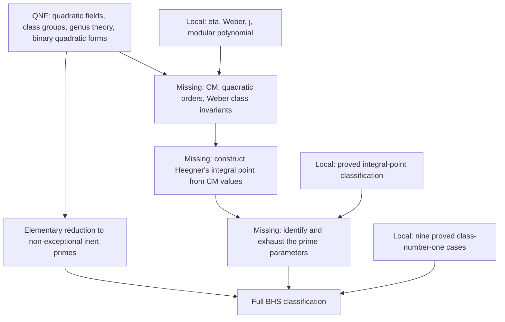

# BakerHeegnerStark

An independent Lean formalization of the **Baker-Heegner-Stark theorem**:
for a negative squarefree integer `d`,

```text
classNumber (ℚ(√d)) = 1 ↔ d ∈ {-1, -2, -3, -7, -11, -19, -43, -67, -163}.
```

The full theorem is not yet proved. Its exact statement is the proposition
`BakerHeegnerStark.ClassNumberOneClassification`.

## Dependency and provenance

The project depends on
[QuadraticNumberFields](https://github.com/WangFrankie/QuadraticNumberFields)
at the immutable commit
[`196dd48b3439cc731397fd2cf9b8ac48da211a22`](https://github.com/WangFrankie/QuadraticNumberFields/commit/196dd48b3439cc731397fd2cf9b8ac48da211a22),
preserved on `legacy/baker-heegner-stark`. This retains the original source,
proof history, authorship, and Apache 2.0 license of the earlier development.
Lean and mathlib are pinned to `v4.35.0`; transitive revisions are recorded in
`lake-manifest.json`.

This repository now owns the non-form-theoretic BHS application proofs:
the nine known cases via Minkowski bounds, the ideal-theoretic reductions,
and the integral points on Heegner's curve. Their original copyright,
authorship, and proofs are retained, with declarations moved from
`QuadraticNumberFields.Heegner` to `BakerHeegnerStark`. Each extracted module
records its source path and immutable revision.

The general modular-function layer has also been extracted from
`QNFMathlib/NumberTheory/ModularForms/` into seven modules under
`BakerHeegnerStark/`: `DiscriminantCoeffs`, `Weber`, `HeckeTwo`,
`HeckeTwoSymmetric`, `JInvariant`, `WeberPolynomial`, and `ModularPolynomialTwo`.
These retain the `ModularForm` namespace, their original proofs and attribution,
and depend only on mathlib and each other, not on QNF arithmetic.

Import these results through `BakerHeegnerStark.*`, not the historical
`QNFMathlib.NumberTheory.ModularForms.*` paths. Mixing both copies would introduce
duplicate declarations with the same mathematical names.

Quadratic-field infrastructure, class groups, genus theory, binary quadratic
forms, reduced-form enumeration and class-group correspondences remain in
QuadraticNumberFields and are reused through narrow imports. In particular,
`ClassNumberOneByForms` and all conductor-two reduced-form counting results are
**not migrated**. The level-two modular polynomial is an analytic modular-function
result, not binary-quadratic-form machinery.

The historical `Weber/Heegner`, conditional `InertPrimes`/`StarkHeegner`, and
the hypothesis-dependent part of `Weber/ConductorTwo` remain in the immutable
snapshot, not in this library's imports. Their `IsAssociatedHeegnerGamma`
relation encodes a finite gamma-prime table; assuming an associated point
already restricts the prime to that table. The missing analytic CM association
must be proved, not imported as an assumption. The two unconditional
elementary branches of historical `StarkHeegner` are retained in
`BakerHeegnerStark/InertPrimes.lean`.

## Current mathematical results

- `classNumber_eq_one_neg1` through `classNumber_eq_one_neg163` and
  `classNumber_eq_one_of_mem_heegnerSet`: the nine known cases, proved locally
  using QNF's Minkowski and prime-splitting results.
- The ideal-theoretic norm obstructions and prime-shape reduction, including
  `eq_neg_seven_of_classNumber_eq_one_of_mod_eight_eq_one`.
- `heegner_xy_solutions` and `heegnerXYEquation_of_mem_heegnerXYSolutionSet`:
  the complete integral-point classification of `Y² = 2X(X³ + 1)`.
- `heegnerGammaImageSet_eq_heegnerGammaSet` and
  `gamma_mem_heegnerGammaSet_of_xy_solution`: the gamma values computed from
  those proved integral solutions, with no assumed association to primes.

- `mem_heegnerSet_or_inert_prime`: class number one either gives a known
  Heegner number or a prime parameter `d = -p`, `p ≡ 3 (mod 8)`, `p ≠ 3`.
- `classNumberOneClassification_iff_inertPrimeClassification`: the full
  classification is equivalent to the remaining non-exceptional inert prime
  case. This is a proved reduction, not a proof of either classification.
- The local analytic layer proves Weber's transformation and product identities,
  the first two symmetric identities, the cubic factorization, and the three
  rational expressions for `j`. It also proves `γ₂³ = j`, modular invariance
  and holomorphy of `j`, and the level-two modular equation at `2τ`, `τ/2`,
  and `(τ+1)/2`. No CM or class-number assumption is needed for these results.
- `eta_mul_I_eq`, `eta_mul_I_im`, and `eta_mul_I_re_pos`: the real product
  expansion, reality, and strict positivity of `η(iy)` for real `y > 0`.
  The proof establishes convergence of the real product, transports it to
  the complex product, proves nonnegativity, and uses eta's nonvanishing.

The reduction uses the proved genus sieve and the ideal-theoretic split-at-two
argument. The conditional Weber classification from the historical development
is not an assumption of these results.

## Proof architecture and remaining gaps

The analytic layer's independence from QNF is a module boundary, not a claim
that the full theorem avoids quadratic-field or binary-quadratic-form theory.
The current Heegner/Weber route needs both. Keeping forms in QNF means reusing
them as dependencies, not excluding them from the final proof.

The intended dependencies are shown below. The CM/order bridge, Heegner
construction, and prime identification are not yet proved.



### What the existing forms results supply

QNF already proves the correspondence between the maximal-order ideal class
group and reduced forms of the field discriminant, via
`classNumber_qsqrtd_eq_reducedForms_card` in
`FormClassGroup/ClassGroup/ClassNumber.lean`.
Its `BinaryQuadraticForms/Core/ConductorTwo.lean` proves that, for squarefree
`-p` with `p ≡ 3 (mod 8)` and `p ≠ 3`, one reduced form of discriminant `-p`
implies exactly three primitive reduced forms of discriminant `-4p`.
Together these give the latter count under the remaining class-number-one
hypothesis. These results remain in QNF and can be imported when needed.

This does **not** yet identify that count with the ideal class number of the
nonmaximal order of conductor two, or with the degree of a CM-generated field.
The maximal-order correspondence is proved; the required nonmaximal-order and
analytic CM connections are the missing part.

### Remaining mathematical work, in development order

1. **Analytic normalization.** Eta's reality and strict positivity on the
   positive imaginary axis are proved in `Eta.lean`. Next deduce positivity
   of the Weber functions, then prove
   `𝔣⁸ = 𝔣₁⁸ + 𝔣₂⁸` and
   `γ₂ = (𝔣²⁴ - 16)/𝔣⁸ = (𝔣₁²⁴ + 16)/𝔣₁⁸ = (𝔣₂²⁴ + 16)/𝔣₂⁸`,
   with the root factors fixed. Equality of cubes alone is insufficient.
2. **Orders, lattices, and CM correspondence.** Connect the conductor-two
   order and its ideal classes to reduced forms and CM values. Identify the
   analytic roots of `Φ₂(j(τ), Y)` with the relevant index-two sublattices
   and order discriminants, including multiplicities.
3. **CM arithmetic: the main theoretical gap.** Prove integrality of singular
   `j`-values, `h(K) = 1 ⇒ j(τ_K) ∈ ℤ` for the maximal-order CM point,
   the required class-number/field-degree relation, and the rationality and
   field membership of the gamma and Weber class invariants. State the
   discriminant and exceptional-case hypotheses precisely. A monic cubic
   equation gives a degree bound, not irreducibility or degree exactly three.
4. **Heegner's algebra and prime identification.** Construct integers `X, Y`
   from the actual CM values, prove `Y² = 2X(X³ + 1)`, and identify the
   analytic gamma value with `heegnerGammaValue X Y`. Apply the proved
   integral-point classification, then recover the prime parameter from
   genuine CM relations. A finite gamma-value set alone does not classify
   primes; the gamma-prime association must be proved, not assumed as a table.
5. **Close the reduction.** Prove `InertPrimeClassification` and apply
   `classNumberOneClassification_iff_inertPrimeClassification` to obtain
   the full classification.

All new proof development, including general modular-function lemmas and
BHS-specific connections to QNF results, belongs in this repository.
The immediate next deliverable is Weber positivity on the positive imaginary
axis, using the proved eta positivity and Weber's product identity. The
remaining proof is not just a few analytic identities: the CM arithmetic
bridge is the principal missing theory.

## Build and verify

```bash
lake exe cache get
lake build
lake lint -- --no-build BakerHeegnerStark
lake env lean scripts/check_axioms.lean
```

`lake build` resolves the pinned dependencies when needed. The cache command
retrieves mathlib's compiled artifacts; QuadraticNumberFields is built from its
pinned source. The axiom audit permits only `propext`, `Classical.choice`, and
`Quot.sound` for the listed proved results.

## Files

- `BakerHeegnerStark/ClassNumberOne.lean`: the nine Minkowski/splitting proofs.
- `BakerHeegnerStark/IdealReductions.lean`: ideal-theoretic norm and prime-shape reductions.
- `BakerHeegnerStark/Diophantine.lean`: Heegner's integral points and their gamma values.
- `BakerHeegnerStark/Statement.lean`: the unconditional classification statement.
- `BakerHeegnerStark/InertPrimes.lean`: the proved elementary branches and inert-prime reduction.
- `BakerHeegnerStark/DiscriminantCoeffs.lean`: low-order `q`-expansion coefficients.
- `BakerHeegnerStark/Eta.lean`: eta's real product expansion and positive-imaginary-axis positivity.
- `BakerHeegnerStark/Weber.lean`: eta quotients, transformation laws, and product identity.
- `BakerHeegnerStark/HeckeTwo.lean`: the weight-12 Hecke identity and first symmetric identity.
- `BakerHeegnerStark/HeckeTwoSymmetric.lean`: the weight-24 second symmetric identity.
- `BakerHeegnerStark/JInvariant.lean`: `j`, `γ₂`, and their basic analytic properties.
- `BakerHeegnerStark/WeberPolynomial.lean`: Weber's cubic and rational expressions for `j`.
- `BakerHeegnerStark/ModularPolynomialTwo.lean`: the level-two modular polynomial and equation.
- `BakerHeegnerStark.lean`: public entry point for the arithmetic and analytic proofs.
- `scripts/check_axioms.lean`: axiom audit of 62 proved results.

Licensed under Apache 2.0; see [LICENSE](LICENSE).
